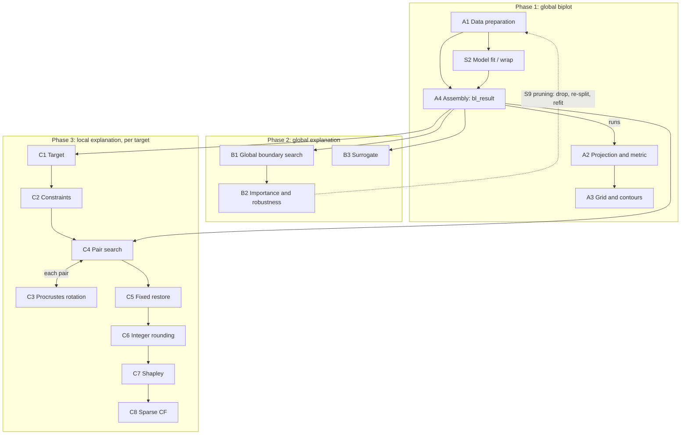

# The algorithms of `boundarylogic`

This note names every main stepwise algorithm that the package code runs and sets out its steps.
A separate section shows the order in which the algorithms run and what each passes to the next.
It describes the code at commit `ef014ca` (`boundarylogic` 0.2.0, 6 November 2026) with the fixes of
its Findings (Section 7, decided and made on 6 November 2026), in the present tense.

**How to read it**

- **What counts as an algorithm.** An algorithm here is a procedure with its own steps and its own
  result: for example the global boundary search, the Procrustes rotation or the greedy sparse
  counterfactual. The shared helpers they call (model scoring, the convex hull, the nearest-vertex
  search and so on) are *supporting procedures*. They are listed in the appendix and referred to
  by their ID.
- **IDs.**
  - A1 to A4: Phase 1, the global biplot.
  - B1 to B3: Phase 2, the global explanation.
  - C1 to C8: Phase 3, the local explanation of one target.
  - S1 to S9: the supporting procedures.
- **Each algorithm** gives its purpose, entry functions, inputs and outputs, and its steps with the
  formulas the code uses. Then come:
  - the defaults that change the result;
  - how ties and randomness are handled;
  - what it calls and what uses it;
  - the thesis section it implements;
  - notes on behaviour worth knowing.
- **Entry functions** are named with their file, without line numbers, which go stale.
- **Thesis citations** are to the final thesis (Rowan, 27 February 2026,
  `documentation/FINAL_ADRIAAN ROWAN_27022026.pdf`), by printed page (PDF page − 16). Its
  appendices are always written "Appendix A3" or "App. A3", never as a bare "A3", which is an
  algorithm ID here.
- **Derivations** are not repeated here. Each algorithm points to the technical note that holds them.

---

## 1. Notation

Vectors of feature values are **row** vectors, as in the code. "Model units" are the units the
model is fitted in: raw units, or standardised units when the features were standardised before
fitting (`bl_set_scaling()`, S8).

| Symbol | Meaning | Code name | Paper 1 |
|---|---|---|---|
| $p$, $n$ | number of features, number of training rows | `num_vars`, `nrow(train_data)` | $p$, $n$ |
| $\mathbf{X}$ | training features, $n\times p$, model units | `train_data[, var_names]` | $\mathbf{X}$ |
| $\mathbf{x}$ | one observation or the target | `x_obs` | $\mathbf{x}$ |
| $\bar{\mathbf{x}}$, $\mathbf{s}$ | training means and standard deviations (total SD) | `X_center`, `X_sd` | |
| $\mathbf{S}$ | $\operatorname{diag}(\mathbf{s})$ when `standardise` is TRUE (PCA), else $\mathbf{I}$ (always under CVA) | `sv` | |
| $\tilde{\mathbf{x}}$ | $(\mathbf{x}-\bar{\mathbf{x}})\mathbf{S}^{-1}$, the centred (and standardised) observation | `X_st`, `x_target_st` | |
| $\mathbf{V}$ | $p\times p$ loading matrix: PCA eigenvectors, or the CVA canonical matrix | `V` (biplotEZ `Lmat`) | $\mathbf{L}$ |
| $\mathbf{V}^{-1}$ | its inverse (equal to $\mathbf{V}'$ under PCA) | `tV` | |
| $\mathbf{V}_r$, $\mathbf{V}^{-1}_r$ | columns `proj_dims` of $\mathbf{V}$ ($p\times2$); rows `proj_dims` of $\mathbf{V}^{-1}$ ($2\times p$) | `Vr`, `tVr` | $\mathbf{L}_r=\mathbf{L}\mathbf{J}_r$ |
| $\mathbf{z}$ | projection onto a plane: $\mathbf{z}=\tilde{\mathbf{x}}\mathbf{V}_r$ | `Z_obs`, `Z_target` | |
| $\hat{\mathbf{x}}(\mathbf{z})$ | back-projection: $\mathbf{z}\mathbf{V}^{-1}_r\mathbf{S}+\bar{\mathbf{x}}$ (the components not plotted are at their mean) | `Bx`, `Xgrid` | |
| $\mathbf{R}$ | the Procrustes rotation of C3; rotated loadings $\mathbf{V}_\rho=\mathbf{V}\mathbf{R}$ | `t(A)`, `Vrho` | $\mathbf{R}$, $\tilde{\mathbf{L}}_r$ |
| $f(\mathbf{x})$ | the model's class-1 probability, floored to 3 decimals (S1) | `.pred_function()` | $f(\mathbf{x})$ |
| $c$, $\varepsilon$ | cutoff (0.5) and boundary band half-width (0.001) | `cutoff`, `b_margin` | $c$, $\varepsilon$ |
| $\mathbf{G}$ | an $m\times m$ grid on a plane | `Zgrid` | $\mathbf{G}$ |
| $\mathcal{B}$ | the contour vertices at levels $c\pm\varepsilon$ | `ct`, `ct_local` | $\mathcal{B}_\varepsilon$ |
| $\mathbf{W}$ | pooled within-group covariance, $\sum_k \mathbf{X}_{kc}'\mathbf{X}_{kc}/(n-g)$ | `metric` | $\mathbf{W}$ |
| $d^2_M(\mathbf{x},\mathbf{y})$ | $(\mathbf{y}-\mathbf{x})\mathbf{W}^{-1}(\mathbf{y}-\mathbf{x})'$, squared Mahalanobis | `dist_mahalanobis` | $d^2$ |
| $d_X(\mathbf{x},\mathbf{y})$ | $\sqrt{\sum_j ((y_j-x_j)/s_j)^2}$, Euclidean in X-space with total-SD scaling | `dist_x` | |
| $d_Z$ | Euclidean distance on the plane | `dist_z` | |
| $\mathcal{H}$ | a convex hull on a plane (S3) | `polygon`, `hull_poly` | |
| $[\ell_j,u_j]$ | training range of feature $j$ (S5) | `train_ranges` | |
| $\mathbf{x}^{cf}$, $\boldsymbol\delta$ | counterfactual, $\boldsymbol\delta=\mathbf{x}^{cf}-\mathbf{x}$ | `B_x`, `data_to_boundary` | $\mathbf{x}^{cf}$, $\boldsymbol\delta$ |
| $\varphi_j$ | Shapley value of feature $j$ | `shapley_cause` | $\varphi_j$ |

**Projection convention.** The same pair of maps is used everywhere a point moves between the
feature space and a plane:

$$\mathbf{z}=(\mathbf{x}-\bar{\mathbf{x}})\,\mathbf{S}^{-1}\,\mathbf{V}_r,\qquad
\hat{\mathbf{x}}(\mathbf{z})=\mathbf{z}\,\mathbf{V}^{-1}_r\,\mathbf{S}+\bar{\mathbf{x}}.$$

In the local search the matrices are replaced by the rotated ones, $\mathbf{V}_\rho[\,,1{:}2]$ and
$\mathbf{V}_\rho^{-1}[1{:}2,\,]$.

---

## 2. Inventory

| ID | Name | Entry function(s) | Thesis |
|---|---|---|---|
| **A1** | Data preparation: binary recoding, seeded split, optional hull peeling | `bl_prepare_data()`, `bl_filter_outliers()` (`R/data_prepare.R`, `R/outlier_filter.R`) | §3.8 steps 1–4 p.72; 90% hull p.127 |
| **A2** | Outcome-group projection and metric | `bl_build_projection()`, `.compute_metric_inverse()` (`R/projection.R`) | §3.2 p.38, §3.3 p.39, §3.4 pp.47–48, p.73 |
| **A3** | Decision-surface grid and boundary contours | `bl_build_grid()` (`R/biplot_grid.R`) | §3.6.1 p.62, §3.7.3 p.70, §3.8 steps 5–9 pp.73–74, §3.8.1 p.76 |
| **A4** | Assembly of the anchor object `bl_result` | `bl_build_result()`, `bl_assemble()` (`R/result.R`) | none |
| **B1** | Global boundary search | `bl_find_boundary()` (`R/boundary.R`) | §3.8 step 11 p.75; §4.2.2 p.101; App. A3 p.181 |
| **B2** | Per-variable boundary distance (variable importance) and robustness | `plot.bl_boundary()`, `bl_robustness()` (`R/boundary_plot.R`) | §4.2.2 p.101, §4.2.3 p.105; App. A5 p.198 |
| **B3** | Biplot-region surrogate | `bl_surrogate()` (`R/surrogate.R`) | §4.2.4 p.108; App. A6 p.201 |
| **C1** | Target selection | `bl_select_target()` (`R/local_cf.R`) | none |
| **C2** | Constraint specification | `set_filters()`, `.parse_constraint()`, `.filter_switches()` (`R/local_cf.R`) | §3.9.2 pp.88–90; §4.3.1 p.116 |
| **C3** | Target-aligned Procrustes rotation | `.bl_rotate()` (`R/local_cf.R`) | §3.5–3.5.2 pp.52–61; App. A2 p.179 |
| **C4** | Component-pair counterfactual search | `bl_find_local_cf()` (`R/local_cf.R`) | §3.9.1 p.86; §4.3.1 pp.113–118; App. A4 p.187, A7 pp.207, 209 |
| **C5** | Fixed-feature restore | `.restore_fixed()` (`R/local_cf.R`) | none (package addition) |
| **C6** | Integer rounding | `.round_integers()` (`R/local_cf.R`) | none (package addition) |
| **C7** | Shapley attribution towards the counterfactual | `bl_shapley()` (`R/shapley.R`) | §4.3.2 p.119; App. A1 p.172, A8 p.214 |
| **C8** | Greedy sparse counterfactual | `bl_find_sparse_cf()` (`R/shapley.R`) | §3.9.2 p.90 (sparse); p.120 |

**Supporting procedures (appendix)**

| ID | Name | Function(s) |
|---|---|---|
| S1 | Model scoring with the 3-decimal floor | `.pred_function()` (`R/predict_utils.R`) |
| S2 | Model fitting and training metrics | `bl_fit_model()`, `.fit_model()`, `calc_gini()`; `bl_wrap_model()` |
| S3 | Convex hull construction and clipping | `.build_hull_polygon()`, `.poly_clip()`, `.points_in_polygon()`, `.grid_in_hull()` (`R/hull_utils.R`) |
| S4 | Nearest-vertex search | `.nearest_idx_block()` (`R/boundary.R`) |
| S5 | Training ranges and the range filter | `get_variable_ranges()`, `get_filter_logical_vector()` (`R/feasibility_utils.R`) |
| S6 | Distance rule and X-space distances | `.resolve_distance()` (`R/utils.R`), `.cf_sq_distance()` (`R/local_cf.R`) |
| S7 | Projecting new points | `bl_project_points()`, `bl_predict()` (`R/project_points.R`) |
| S8 | Raw-unit scaling | `bl_set_scaling()`, `bl_apply_scaling()`, `.scale_to_raw()` (`R/data_prepare.R`) |
| S9 | Variable pruning and refit (script-level procedure) | `development/03_loan_status_Boundary_Logic.R`; Pima `02_global.R`, `02b_prune-refit.R` |

---

## 3. Phase 1: the global biplot

### A1. Data preparation

**Purpose.** Turn a data frame into a binary training set and a test set, and optionally remove
training outliers.

**Entry.** `bl_prepare_data()` (`R/data_prepare.R`), which ends by calling `bl_filter_outliers()`
(`R/outlier_filter.R`). `bl_wrap_data()` is the alternative entry for prepared data and an
externally fitted model: it does no split and no filtering, and returns a `bl_data` object.

**Inputs.** `data`, `class_col`, `target_class`, `feature_cols`, `train_fraction`, `seed`,
`hull_fraction`.
**Outputs** (`bl_filter_result`):
- `train_data`, filtered, and `test_data`, never filtered;
- `var_names`, `num_vars`, `target_class`;
- `polygon`, `hull_fraction`, `n_retained`, `n_removed`, and `scaling` passed through.

**Steps.**
1. **Recode the class.** With `target_class` given, $y_i=\mathbb{1}[\text{class}_i=\text{target\_class}]$.
   Without it, the class column must already hold only 0 and 1.
2. **Select the columns.** Keep `feature_cols` (by default every column except `class_col`), plus
   the recoded column `class`.
3. **Split.** Call `set.seed(seed)` and draw `train_idx = sample(n, floor(train_fraction * n))`. The
   remaining rows form the test set, and row names are reset.
4. **Hull peeling** (`bl_filter_outliers()`), on the training rows only:
   1. standardise the training features by their own means and SDs (an SD of 0 is set to 1);
   2. project them onto their first two principal components ($\mathbf{Z}=\mathbf{X}_{st}\mathbf{v}_{1:2}$
      from `svd()`), a *proxy* plane that is not the final biplot;
   3. build the hull of that cloud with fraction `hull_fraction` (S3);
   4. keep the rows inside it;
   5. warn if fewer than 10 rows remain.

**Defaults that change the result.**
- `train_fraction = 0.8` and `seed = 121L`.
- `hull_fraction`: 1 in `bl_prepare_data()` (the full hull, no peeling; since 2026-11-05), but 0.9
  in `bl_filter_outliers()` when called on its own. The loan harness and vignette pass 0.9, the Pima
  example 1.

**Ties and randomness.** `set.seed()` resets the session's random-number state. Any later
random step that sets no seed of its own (for example the starting weights of an NNET fit, S2)
therefore follows from `seed`.

**Calls.** S3. **Used by.** A2–A4, through the training data and the test data.

**Thesis.** The steps of the biplot method start from the training and test data (§3.8, steps
1–4, p.72). The thesis removed the points outside the 90% convex hull in its loan example (p.127).

**Notes.**
- The split depends only on the rows and the seed. Re-running it with fewer `feature_cols` gives
  the same train/test split, which S9 relies on.
- The peeling, however, depends on the features: the proxy plane is rebuilt from the remaining
  ones. With `hull_fraction < 1` the retained training rows can therefore differ. With 1 (Pima)
  they are the same.
- The peeling polygon lies on the proxy plane and is not used later. A3 builds its own hull.

### A2. Outcome-group projection and metric

**Purpose.** Build the biplot's loading matrix (PCA or CVA) from the training data. For CVA, use
the model's four prediction outcomes as the groups. Also compute the within-group metric
$\mathbf{W}$ that later measures distances.

**Entry.** `bl_build_projection()`, with `.compute_metric_inverse()` (`R/projection.R`). It is
called by `bl_build_result()` (A4).

**Inputs.** `train_data`, `var_names`, `method`, `standardise`, `proj_dims`, `bl_model`,
`cva_classes`.
**Outputs** (`bl_projection`):
- the projection: `V`, `tV`, `X_center`, `X_sd`, `method`, `standardise`, `proj_dims`, `biplot_obj`;
- the groups and display: `cva_classes`, `point_col`;
- the ranges and metric: `train_ranges`, `metric`, `metric_inv`, `metric_type`;
- `condition_number`.

**Steps.**
1. Under CVA, set `standardise` to FALSE whatever was passed.
2. Set $\bar{\mathbf{x}}$ = the column means and $\mathbf{s}$ = the column SDs of $\mathbf{X}$.
3. **PCA:** `biplotEZ::biplot(X, scaled = standardise) |> PCA(e.vects = proj_dims)`.
4. **CVA groups:**
   - When a model is given and no `cva_classes`: score the training rows with S1 and set
     $\hat y_i=\mathbb{1}[f(\mathbf{x}_i)\ge c]$.
   - Label each row TP, TN, FP or FN from $(y_i,\hat y_i)$.
   - Make a factor with the fixed level order `FN, FP, TN, TP`. A message names any empty group, and
     `droplevels()` removes it.
   - Warn if fewer than 3 groups remain.
   - Without a model, A4 passes `as.factor(class)`, giving 2 groups.
5. **CVA:** `biplotEZ::biplot(X, scaled = FALSE) |> CVA(e.vects = proj_dims, classes = cva_classes)`.
6. Take $\mathbf{V}$ = `bp$Lmat` ($p\times p$). Warn if its condition number exceeds $10^{10}$. Compute
   $\mathbf{V}^{-1}$ with `solve()`.
7. Compute the training ranges $[\ell_j,u_j]=\operatorname{range}(\mathbf{X}_{\cdot j})$ (S5).
8. **The metric** (`.compute_metric_inverse()`), on the unstandardised $\mathbf{X}$:
   1. choose the grouping by priority:
      - the CVA groups, giving `W_cva`;
      - otherwise the binary class, giving `W_binary` (the PCA case);
      - otherwise none, giving $\mathbf{W}=\operatorname{cov}(\mathbf{X})$, `Sigma`;
   2. compute $\mathbf{W}=\sum_k \mathbf{X}_{kc}'\mathbf{X}_{kc}/\max(n-g,1)$, with each group centred on its
      own means. A group with fewer than 2 rows adds nothing but still counts in $g$;
   3. invert: $\mathbf{W}^{-1}$ = `chol2inv(chol(W))`. If Cholesky fails, use
      `chol2inv(chol(W + λI))` with $\lambda=10^{-6}\,\overline{\operatorname{diag}(\mathbf{W})}$. The stored
      `metric` is the unregularised $\mathbf{W}$.

**Defaults that change the result.**
- `method = "PCA"` and `standardise = TRUE` in `bl_build_result()`.
- `proj_dims = c(1, 2)`.
- The CVA level order `FN, FP, TN, TP` is part of the result. Another order perturbs $\mathbf{V}$
  numerically, and through C3 moves every Phase 3 number.

**Calls.** S1 (CVA groups), S5. **Used by.**
- $\mathbf{V}$, $\mathbf{V}^{-1}$, $\bar{\mathbf{x}}$, $\mathbf{s}$: every projection and back-projection
  (A3, B1–B3, C1, C3, C4, S7).
- $\mathbf{W}$: B2.
- $\mathbf{W}^{-1}$: B1, B2, C4, C6.

**Thesis.**
- Mahalanobis distance §3.2 (p.38); PCA biplot §3.3 (p.39); CVA biplot §3.4 (pp.47–48).
- The thesis's $\mathbf{W}$ is the within-group SSP (p.48), without the $(n-g)$ divisor.
- The four prediction-outcome groups: p.73.

**Notes.**
- Under PCA, $\mathbf{V}$ is orthogonal. Under CVA it is not, which is why the code inverts it
  rather than transposing it.
- Under CVA the plane distance and the Mahalanobis distance are linked by
  $d^2_M=(n-g)\,d_Z^2$ for points on the plane. The derivation is in
  `documentation/biplot-rotation/biplot_rotation_and_pair_selection.md` §3.4, and the metric in
  `documentation/boundary-distance-and-robustness.md` §1.

### A3. Decision-surface grid and boundary contours

**Purpose.** Approximate the model's decision surface on the biplot plane: predict a fine grid of
plane points through their back-projections, then extract the decision boundary as contour lines.

**Entry.** `bl_build_grid()` (`R/biplot_grid.R`), called by `bl_build_result()` when a model is
given.

**Inputs.** `train_data`, the `bl_projection` (A2), the `bl_model`, `m`, `cutoff`, `b_margin`,
`outlie`, `calc_hull`.
**Outputs** (`bl_grid`):
- the grid: `Zgrid`, `Xgrid`, `grid_prob`, `col_value`, `min_val`, `max_val`, `xseq`, `yseq`;
- the hull: `polygon`, `hull_fraction`;
- the contours: `ct`, `ct_surrogate`, `b_margin`, `cutoff`.

**Steps.**
1. Project the training rows: $\mathbf{Z}_{train}=\tilde{\mathbf{X}}\mathbf{V}_r$.
2. **Bounds.** Render the biplotEZ axes on an off-screen device and take
   $[\min(\text{usr}_{1,3}),\max(\text{usr}_{2,4})]$, a square that contains the calibrated axes. If
   the render fails, fall back to the range of $\mathbf{Z}_{train}$, with a warning.
3. **Grid.** Take $m$ equally spaced values on each axis. $\mathbf{G}$ = all $m^2$ pairs
   (`expand.grid`).
4. **Back-project.** $\mathbf{X}_G=\mathbf{G}\,\mathbf{V}^{-1}_r\,\mathbf{S}+\mathbf{1}\bar{\mathbf{x}}$.
5. **Hull.** Unless a polygon is supplied, build the hull of $\mathbf{Z}_{train}$ with fraction
   `outlie` (S3), and mark the grid points inside it.
6. **Score.** Compute $f(\mathbf{X}_G)$ in chunks of 50 000 rows (S1). Clamp to $[0,1]$, warning if
   any value had to be clamped.
7. **Colour** (display): index a 101-step ramp by $\lfloor 100f\rfloor+1$.
8. **Boundary contours.** Compute $\mathcal{B}$ = `contourLines(xseq, yseq, matrix(f, m), levels = c(c − ε, c + ε))`.
   The decision boundary is the band between the two lines:
   - the line at $c-\varepsilon$ lies on the class-0 side;
   - the line at $c+\varepsilon$ lies on the class-1 side.
9. **Surrogate contours.**
   1. Copy the surface and set every cell outside the hull to $c$.
   2. Extract the levels $c-\varepsilon$, $c$ and $c+\varepsilon$.
   3. Drop the level $c$. The result is `ct_surrogate`, whose lines close inside the hull (B3).
10. **Trim** (when `calc_hull`): keep only the grid points inside the hull in `Zgrid`, `Xgrid`,
    `grid_prob` and `col_value`. The contours of steps 8–9 come from the untrimmed grid.

**Defaults that change the result.** `m = 200`, `cutoff = bl_model$cutoff` (0.5; must not be
changed), `b_margin = 0.001` (must satisfy $0<\varepsilon<0.5$), `outlie = 1` (the full hull).

**Calls.** S1, S3. **Used by.**
- `ct` and `polygon`: B1.
- `ct_surrogate`: B3.
- The grid: the global biplot plots.

**Thesis.**
- Decision-boundary intervals: §3.6.1 (p.62).
- Grid search: §3.7.3 (p.70).
- The step list of the biplot method: §3.8 (steps 5–9, pp.73–74: project, grid, map back, shade,
  contour).
- Visualising the model on the plane: §3.8.1 (p.76).

**Notes.** The scores are floored to 3 decimals (S1), so with $\varepsilon=0.001$ the two contour
levels lie one step either side of the cutoff.

### A4. Assembly of the anchor object

**Purpose.** Run A2 and A3 in order and gather what every later algorithm needs into one
`bl_result` object.

**Entry.** `bl_build_result()`, which calls `bl_build_projection()` (A2), `bl_build_grid()` (A3,
skipped without a model) and `bl_assemble()` (`R/result.R`).

**Inputs.**
- the prepared data (A1);
- the model (S2);
- the arguments for A2: `method`, `proj_dims`, `standardise`, `cva_classes`;
- the arguments for A3: `m`, `outlie`, `calc_hull`, `b_margin`.

**Outputs** (`bl_result`):
- the data and model: train/test data, `var_names`, model, `cutoff`, `b_margin`;
- from A2: `V`, `tV`, `X_center`, `X_sd`, `method`, `standardise`, `proj_dims`, `metric`,
  `metric_inv`, `metric_type`, `train_ranges`;
- from A3: `polygon`, `hull_fraction`, and `biplot_grid`, the whole `bl_grid`;
- `scaling`.

**Steps.**
1. If CVA is chosen without a model or `cva_classes`, pass `as.factor(train_data$class)` to A2.
2. Run A2.
3. Run A3 if a model is given.
4. Stop if the grid's cutoff differs from the model's.
5. If the test set is empty (`train_fraction = 1`), use the training set as the test set, with a
   message.
6. Take `polygon` and `hull_fraction` from the grid (A3), never from A1's proxy plane.
7. Copy the scaling (S8) from the data object.

**Used by.** Every Phase 2 and Phase 3 algorithm.

---

## 4. Phase 2: global explanation

### B1. Global boundary search

**Purpose.** For each observation, find the nearest point on the boundary contour of the opposite
predicted class in the biplot plane. Its back-projection is that observation's global
counterfactual.

**Entry.** `bl_find_boundary(bl_result, data = NULL, tdp = NULL)` (`R/boundary.R`). By default it
uses `test_data`.

**Inputs.** From `bl_result` (A4): $\mathbf{V}_r$, $\mathbf{V}^{-1}_r$, $\bar{\mathbf{x}}$, $\mathbf{s}$,
$c$, `polygon`, `train_ranges`, $\mathbf{W}^{-1}$, and the contours `ct` (A3). Also the rows to
search.
**Outputs** (`bl_boundary`):
- the boundary points: `B_z`, `B_x`, `B_pred`;
- the distances: `dist_z`, `dist_x`, `dist_mahalanobis`;
- the observations: `Z_obs`, `x_obs`, `pred_obs`, `class_obs`;
- the contours: `z_boundaries_list`, `z_boundary_type`, `nr_boundaries`, `position_store`.

**Steps.**
1. **Project and score** the observations: $\mathbf{z}_i=\tilde{\mathbf{x}}_i\mathbf{V}_r$, and
   $\hat y_i=\mathbb{1}[f(\mathbf{x}_i)\ge c]$.
2. **Clip.** For each contour in `ct`, keep the vertices inside the global hull (S3, `.poly_clip()`).
   Record each contour's level.
3. **Keep contours near the data.** This step runs on the clipped contours, and only when there is
   a global hull.
   - A contour that is still closed after clipping (first vertex equal to the last) is kept only if
     at least one *training* row, projected as in step 1, lies inside or on it (`.encloses_data()`,
     S3). The rows being searched play no part, so a row's result does not depend on the other rows
     searched (since 2026-11-06; Finding F2).
   - Every other contour is kept, including a closed contour that the hull cut open.
   - If none is kept, all are used, with a warning.
4. **Consistency pruning.** Back-project each vertex, $\hat{\mathbf{x}}(\mathbf{b})$, and score it. Keep it
   only if its prediction agrees with its contour's side:
   - $f<c$ on the $c-\varepsilon$ line;
   - $f\ge c$ on the $c+\varepsilon$ line.

   Drop the contours left empty. The training ranges are deliberately not applied here (see Notes).
5. **Nearest vertex per contour.** For each observation and each contour, find the nearest vertex
   in 2D Euclidean distance (S4).
6. **Opposite side.** For each observation, take the nearest of those vertices:
   - among the class-0 contours (level $<c$) for a predicted class-1 observation;
   - among the class-1 contours (level $\ge c$) for a predicted class-0 observation.

   Use `which.min`, which takes the first on a tie. This gives $\mathbf{b}_i$ (`B_z`).
7. **Back-project.** $\mathbf{x}^{cf}_i=\hat{\mathbf{x}}(\mathbf{b}_i)$ (`B_x`), a rank-2 reconstruction.
8. **Report the range check.** Count the $\mathbf{x}^{cf}_i$ outside the training ranges (S5) and give
   the count in a message. No point is removed.
9. **Score** $f(\mathbf{x}^{cf}_i)$ (`B_pred`).
10. **Distances:**
    - $d_Z=\lVert\mathbf{z}_i-\mathbf{b}_i\rVert$;
    - $d_X(\mathbf{x}_i,\mathbf{x}^{cf}_i)$;
    - $d^2_M(\mathbf{x}_i,\mathbf{x}^{cf}_i)$, squared (NA, with a warning, when $\mathbf{W}^{-1}$ is missing).

**Ties and randomness.** Deterministic: S4 takes the first nearest vertex, and step 6 the first
nearest contour.

**Calls.** S1, S3, S4, S5. **Used by.** B2, `bl_pick_point()` (display), and the scripts'
global summaries.

**Thesis.**
- The biplot counterfactual: §3.8, step 11 (p.75).
- The nearest counterfactual of every data point, as the basis of variable importance: §4.2.2
  (p.101).
- Appendix A3, Biplot Boundary Search (p.181).

**Notes.**
- **The search is in the plane.** The nearest point is chosen by $d_Z$. $d_X$ and $d^2_M$ are
  measured afterwards, from the observed $\mathbf{x}_i$, which in general does not lie on the plane.
  They are reported only: no global or local interpretation uses them (B2 measures its own, in-plane
  gap; Finding F3). The Pima example of Paper 1 uses $\sqrt{d^2_M}$ to choose its two targets.
  Why the Mahalanobis distance uses $\mathbf{W}$ and not a rotated $\mathbf{W}$ is explained in
  `documentation/boundary-distance-and-robustness.md` §2.1.
- **The training ranges are applied after the selection,** so they never replace the nearest point
  with a farther one. The reason is in the methodology note §3.3
  (`documentation/methodology-changes/`).
- See Findings F1 and F2.

### B2. Per-variable boundary distance and robustness

**Purpose.** Measure, per variable, how far the observations lie from their global
counterfactuals, standardised so that variables can be compared. The totals rank the variables
(global variable importance), and their sum is the robustness score.

**Entry.** `plot.bl_boundary(x, type, distance = "auto")`, which plots, prints a summary and
returns the values. `bl_robustness(bl_boundary, distance = "auto")` returns the same totals
without the plot or the check (`R/boundary_plot.R`).

**Inputs.** From B1: $\mathbf{Z}_{obs}$, $\mathbf{B}_z$, `pred_obs`, `class_obs`. From A4:
$\mathbf{V}^{-1}_r$, $\mathbf{s}$, `standardise`, $\mathbf{W}$, $\mathbf{W}^{-1}$, `method`.
**Outputs.** Both functions return `sum_of_distance` ($T_j$), `robustness` and `distance`. The
plot method also returns `vec_to_boundary_sd`, `mahalanobis_check` and the plot.

**Steps.**
1. **Resolve the distance** (S6): `"auto"` gives `"euclidean"` under PCA and `"mahalanobis"` under
   CVA. Without $\mathbf{W}$, fall back to Euclidean with a warning.
2. **Signed gap in feature units.**
   $\mathbf{v}_i=(\mathbf{z}_i-\mathbf{b}_i)\,\mathbf{V}^{-1}_r\,\mathbf{S}$. This is the observation's
   rank-2 reconstruction minus the counterfactual: the move along the plane to the boundary, as in
   the thesis. It is not B1's gap, by design (Finding F3).
3. **Standardise.** Compute $\tilde v_{ij}=v_{ij}/\sigma_j$, with:
   - $\sigma_j=\sqrt{W_{jj}}$ (within-group SD) for `"mahalanobis"`;
   - $\sigma_j=s_j$ (total SD) for `"euclidean"`.
4. **Per-variable total.** $T_j=\sum_i|\tilde v_{ij}|$, a sum of absolute values.
5. **Robustness.** $\sum_j T_j$.
6. **Display** (plot method only):
   - variables are sorted by $T_j$;
   - points are coloured by TP/TN/FP/FN, or by the predicted class when the labels are unknown;
   - `type = "boxplot"` changes only the geometry of the plot, not $T_j$.
7. **Mahalanobis check** (plot method, `"mahalanobis"` only). Compare the plotted measure
   $\sum_i\sum_j\tilde v_{ij}^2=\sum_i\sum_j v_{ij}^2/W_{jj}$ with the full
   $\sum_i\mathbf{v}_i\mathbf{W}^{-1}\mathbf{v}_i'$. Report the difference and its percentage of the full
   value, with a note when it is 25% or more.

**Calls.** S6. **Used by.** S9 (variable pruning).

**Thesis.**
- Variable importance from the distance to the boundary: §4.2.2 (p.101); robustness §4.2.3 (p.105).
- Appendix A5, Global Interpretations of Robustness and Variable Importance (p.198).
- The per-variable standardisation rule: `documentation/boundary-distance-and-robustness.md`.

**Notes.**
- The diagonal standardisation ignores the correlations in $\mathbf{W}$; the check measures what
  that leaves out. The full Shapley decomposition is deferred work (CLAUDE.md §9).
- See Finding F3.

### B3. Biplot-region surrogate

**Purpose.** Use the biplot regions as a surrogate classifier. Each observation inside the hull
takes the class of the surrogate contour nearest to it, and the surrogate's agreement with the
model and with the labels is reported.

**Entry.** `bl_surrogate(bl_result, data = NULL)` (`R/surrogate.R`). By default it uses
`train_data`. Nothing is fitted.

**Inputs.** `ct_surrogate` and `polygon` (A3), $\mathbf{V}_r$, $\bar{\mathbf{x}}$, $\mathbf{s}$, $c$.
**Outputs.**
- `surrogate_pred`, `model_pred`, `class_obs`, `boundary_set_nr`;
- `accuracy_vs_model`, `accuracy_vs_labels`;
- `n_total`, `n_in_hull`, `hull_coverage`.

**Steps.**
1. Project and score the observations, as in B1 step 1.
2. **Hull test.** Observations outside the global hull get NA, and a message gives the count.
3. **Clip.** Keep the surrogate contours' vertices inside the hull, and drop empty contours. There
   is no consistency pruning and no enclosure rule.
4. **Nearest contour.** For each observation inside the hull, find the nearest vertex on every
   contour (S4) and take the contour with the smallest squared $d_Z$ (`which.min`).
5. **Surrogate class.** $\mathbb{1}[\text{level}\ge c]$ of that contour.
6. **Fidelity.**
   - Agreement with the model's class, and with the labels, over the observations inside the hull.
   - Coverage: the share of observations inside the hull.

**Calls.** S1, S4. **Used by.** `plot.bl_surrogate()` (display). Paper 1 does not use it.

**Thesis.** §4.2.4, the biplot as a surrogate model with global fidelity (p.108). Appendix A6 (p.201).

---

## 5. Phase 3: local explanation (one target)

### C1. Target selection

**Purpose.** Fix the observation to explain, with its prediction and true class.

**Entry.** `bl_select_target(bl_result, target, data = NULL)` (`R/local_cf.R`).

**Inputs.** A row index into `data` (by default `test_data`), or a one-row data frame in model
units.
**Outputs** (`bl_target`): `x_obs`, `z_obs`, `pred_prob`, `pred_class`, `row_id`, `class_obs`,
`scaling`.

**Steps.**
1. Take $\mathbf{x}$ from the row, or from the data frame. A data-frame target is checked against the
   training ranges (S5), with a warning when it is outside. The warning suggests
   `bl_apply_scaling()` (S8) when converting would reduce the number of features out of range.
2. Read the true class from the `class` column, else from the first column that is not a feature,
   else set it to NA.
3. Project onto the global plane: $\mathbf{z}=\tilde{\mathbf{x}}\mathbf{V}_r$.
4. Score: $f(\mathbf{x})$, and $\hat y=\mathbb{1}[f(\mathbf{x})\ge c]$.

**Calls.** S1, S5. **Used by.** C2–C8.
- $\hat y$ decides which side of the boundary the counterfactual must reach.
- $\mathbf{x}$ is the origin of every distance and of the Shapley values.
- `z_obs` is not used by the search.

### C2. Constraint specification

**Purpose.** Collect the three rules the local counterfactual must satisfy:
- **actionability:** per-variable constraints;
- **plausibility:** the hull on each plane;
- **feasibility:** the training ranges.

**Entry.** `set_filters(bl_target, ..., hull = TRUE, train_ranges = TRUE)` (`R/local_cf.R`), with
`.parse_constraint()` and `.filter_switches()`.

**Inputs.** The target (C1), one constraint per named feature, and the two switches.
**Outputs** (`bl_filters`): `constraints`, `bl_target`, `hull`, `train_ranges`.

**Steps.**
1. Check that every named feature exists and that every constraint has a valid form.
2. **Parse each constraint** (`.parse_constraint()`) into a type and an `integer` flag:

   | Form | Type | Integer flag |
   |---|---|---|
   | `"increase"`, `"decrease"`, `"fixed"` | the direction | FALSE |
   | `c(min, max)` | `range` | FALSE |
   | `"integer"` | `none` | TRUE |
   | `c(direction, "integer")` | the direction | TRUE |
   | `list(c(min, max), "integer")` | `range` | TRUE |

3. **Read the switches** (`.filter_switches()`). A missing or NULL switch reads as TRUE. So
   `set_filters = NULL` in C4 keeps the hull and the training ranges on.

**Used by.**
- C4: the actionability test (`.apply_actionability()`) and the two switches.
- C5: the `"fixed"` features.
- C6: the `"integer"` features, excluding those that are also fixed.
- C8: the fixed features are never changed.

**The actionability test** (applied in C4 and C6). A candidate $\mathbf{b}_x$ passes when every
constrained feature $j$ satisfies its rule:
- `"decrease"`: $b_{x,j}\le x_j$;
- `"increase"`: $b_{x,j}\ge x_j$;
- `"fixed"`: $|b_{x,j}-x_j|\le 0.5$ in model units (`.fixed_tol`);
- `range`: $\min\le b_{x,j}\le\max$.

`"integer"` is not tested here; C6 applies it.

**Thesis.**
- The three rules are defined in §3.9.2 (pp.88–90) and applied in §4.3.1 (p.116).
- The hull is the plausibility rule (p.117). Without constraints the counterfactual is the
  unconstrained one (p.115).
- More: `documentation/local-convex-hull.md` §6.

### C3. Target-aligned Procrustes rotation

**Purpose.** For a given pair of components, rotate the full loading matrix so that the target is
represented exactly on the first two rotated axes.

**Entry.** `.bl_rotate(x_target_st, V, proj_pair)` (`R/local_cf.R`). It is called once per pair
inside C4.

**Inputs.** $\tilde{\mathbf{x}}$ (the standardised target), $\mathbf{V}$, the pair $(a,b)$.
**Outputs.** $\mathbf{V}_\rho[\,,1{:}2]$ (`Vr_rot`, $p\times2$) and $\mathbf{V}_\rho^{-1}[1{:}2,\,]$
(`tVr_rot`, $2\times p$).

**Steps.**
1. Build the three-point configuration $\mathbf{Y}=\begin{bmatrix}-\tilde{\mathbf{x}}\\ \mathbf{0}\\ \tilde{\mathbf{x}}\end{bmatrix}$ ($3\times p$).
2. Compute $\mathbf{P}=\mathbf{Y}\mathbf{V}$, the configuration in all $p$ components, and
   $\mathbf{Q}=[\,\mathbf{Y}\mathbf{V}_{(a,b)}\;\;\mathbf{0}\,]$, its projection onto the pair, zero-padded
   to $3\times p$.
3. Take the SVD $\mathbf{P}'\mathbf{Q}=\mathbf{U}\boldsymbol\Lambda\mathbf{T}'$, and set
   $\mathbf{R}=\mathbf{U}\mathbf{T}'$. This is the orthogonal Procrustes solution of
   $\min_{\mathbf{R}}\lVert\mathbf{P}\mathbf{R}-\mathbf{Q}\rVert_F$, with no dilation. In the code,
   $\mathbf{A}=\mathbf{T}\mathbf{U}'$ and $\mathbf{R}=\mathbf{A}'$.
4. Rotate: $\mathbf{V}_\rho=\mathbf{V}\mathbf{R}$, and $\mathbf{V}_\rho^{-1}$ = `solve(Vrho)`, which is
   valid under CVA, where $\mathbf{V}$ is not orthogonal.
5. Return columns 1–2 of $\mathbf{V}_\rho$ and rows 1–2 of $\mathbf{V}_\rho^{-1}$. The target's
   information lies in those two columns whatever the pair.

**Ties and randomness.** Deterministic for identical inputs on one platform.

**Used by.** C4, then C5 and C6 for their re-projection.

**Thesis.**
- Optimal rotation of the biplot: §3.5 (p.52); its example §3.5.1 (p.56); rotation of a CVA biplot
  §3.5.2 (p.61).
- Appendix A2, Optimal Rotation of a Biplot (p.179).

**Notes.**
- **The plane is under-determined.** $\mathbf{Y}$ has rank 1, so the minimiser is fixed only along
  the target's direction. The plane's second direction is LAPACK's tie-break.
- This is inherited from the PhD method, documented, and deliberately not changed (CLAUDE.md §9).
  The proposed deterministic replacement is in
  `documentation/biplot-rotation/biplot_rotation_and_pair_selection.md` §4.1 and §5.
- A target at the centre of the biplot ($\lVert\tilde{\mathbf{x}}\rVert\approx0$) makes the rotation
  undefined. C4 then warns.

### C4. Component-pair counterfactual search

**Purpose.** On each of a set of rotated planes, approximate the decision boundary near the target
and find the nearest boundary point that satisfies every rule. Then choose, across the planes, the
one whose counterfactual is nearest by the distance rule.

**Entry.** `bl_find_local_cf(bl_result, bl_target, set_filters = NULL, max_pairs = 21L, m = 200L, distance = "auto")`
(`R/local_cf.R`).

**Inputs.**
- From A4: $\mathbf{V}$, $\bar{\mathbf{x}}$, $\mathbf{s}$, $c$, $\varepsilon$, $\mathbf{W}^{-1}$,
  `train_ranges`, the training data, and the model.
- From C1: the target.
- From C2: the rules.

**Outputs** (`bl_local_result`):
- the counterfactual: `B_z`, `B_x`, `B_pred`;
- the distances: `dist_z`, `dist_x`, `dist_mahalanobis`;
- the winning plane: `best_pair`, `Z_target`, `Vr_rot`, `tVr_rot`, `Z_train_rot`, `Zgrid`,
  `grid_prob`, `ct_local`, `hull_polygon`;
- the per-pair distances: `all_distances`, `all_distances_x`, `all_distances_mahalanobis`;
- the status: `distance`, `hull`, `train_ranges`, `solution_found`, `blocking_constraint`;
- the companion objects: `bl_target`, `bl_counterfactual`, `fixed_check`, `integer_check`.

**Steps.**

*Set-up*
1. Read the switches (C2). With the feasibility switch off, the training ranges are NULL for this
   search and for C5 and C6.
2. Resolve the distance rule (S6): `"auto"` gives `"euclidean"` under PCA and `"mahalanobis"`
   under CVA. Without $\mathbf{W}^{-1}$, fall back to Euclidean with a warning.
3. Standardise the target and the training rows: $\tilde{\mathbf{x}}$, $\tilde{\mathbf{X}}$. Warn if
   $\lVert\tilde{\mathbf{x}}\rVert$ is below $\sqrt{\epsilon_{mach}}$.
4. List the pairs in colexicographic order, $(1,2),(1,3),(2,3),(1,4),(2,4),(3,4),\dots$, and stop
   after `max_pairs`.

*For each pair $(a,b)$, in that order*

5. **Rotate** (C3). Project the target, $\mathbf{z}_t=\tilde{\mathbf{x}}\mathbf{V}_\rho[\,,1{:}2]$, and the
   training rows, $\mathbf{Z}_{tr}=\tilde{\mathbf{X}}\mathbf{V}_\rho[\,,1{:}2]$.
6. **Grid bounds.** Take the range of $\mathbf{Z}_{tr}$ over both axes together, padded by 10% on each
   side. This gives a square.
7. **Hull** (when `hull`). Build the full convex hull of the rows of $\mathbf{Z}_{tr}$ on this plane
   (S3, fraction 1); the target is not part of it (since 2026-11-06). It is rebuilt for every pair;
   the global hull is never used here.
8. **Grid.** An $m\times m$ grid $\mathbf{G}$, back-projected with the rotated matrices
   ($\mathbf{X}_G=\mathbf{G}\,\mathbf{V}_\rho^{-1}[1{:}2,\,]\,\mathbf{S}+\mathbf{1}\bar{\mathbf{x}}$), scored
   (S1) and clamped to $[0,1]$, as in A3, with one warning per call that counts the clamped cells
   over all pairs (since 2026-11-06).
9. **Contours.** $\mathcal{B}$ at levels $c\pm\varepsilon$. Skip the pair if there are none.
10. **Filter cascade**, for each contour, in this order (a contour skips to the next once none of
    its vertices is left):
    1. *Opposite class.* Keep only the contour on the side the target must reach: $c+\varepsilon$
       for a predicted class-0 target, $c-\varepsilon$ for class 1.
    2. *Plausibility* (when `hull`). Keep the vertices inside the plane's hull (S3, `.poly_clip()`).
       A contour still closed after the clip is kept only if it encloses training data on the plane
       (`.encloses_data()` with $\mathbf{Z}_{tr}$), the empty-region rule of B1 step 3 (since
       2026-11-06).
    3. Back-project the vertices.
    4. *Actionability.* Apply the test of C2.
    5. *Feasibility.* Keep the vertices within the training ranges (S5), testing only the survivors.
    6. *Model consistency.* Re-score the survivors, and keep those whose prediction agrees with the
       contour's side ($f<c$ on the $c-\varepsilon$ line, $f\ge c$ on the $c+\varepsilon$ line).

    Skip the pair if no vertex survives.
11. **Nearest valid vertex.** Pool the survivors and take the vertex nearest $\mathbf{z}_t$ in 2D
    Euclidean distance (S4). This is $\mathbf{b}$, with $d_Z=\lVert\mathbf{z}_t-\mathbf{b}\rVert$.
12. **Distances in X-space.** For $\mathbf{x}^{cf}=\hat{\mathbf{x}}(\mathbf{b})$, compute
    $d^2_M(\mathbf{x},\mathbf{x}^{cf})$ and $d_X(\mathbf{x},\mathbf{x}^{cf})$ (S6). Store $d_Z$, $d_X$ and $d^2_M$
    for the pair.
13. **Pair selection.** The selector is $d^2_M$ for `"mahalanobis"` and $d_X$ for `"euclidean"`.
    The pair becomes the running best if its selector is finite and strictly smaller. Only then is
    $f(\mathbf{x}^{cf})$ computed and the plane's state saved.

*After the loop*

14. A solution exists if any pair produced a valid vertex. With the hull switched off, the winning
    plane's hull is still built, for the plot only. Without a solution, `blocking_constraint`
    explains which rules were active.
15. Run C5, then C6. Either can turn a solution into no solution.
16. Package the counterfactual as `bl_counterfactual`: $\mathbf{x}^{cf}$ and $\mathbf{z}^{cf}$ in model
    units, its prediction and class, and the scaling for display.

**Defaults that change the result.**
- `max_pairs = 21`: all $\binom{p}{2}$ pairs for $p\le7$, and only the first 21 for $p\ge8$.
- `m = 200`.
- `distance = "auto"`.
- The 0.5-unit `"fixed"` tolerance.
- The 10% grid padding.

**Ties and randomness.** Deterministic. Within a pair, S4 takes the first nearest vertex in
contour order. Across pairs, the strict $<$ keeps the earlier pair on a tie.

**Calls.** C3, S1, S3, S4, S5, S6, and C5, C6. **Used by.** C7, C8 and the local plots.

**Thesis.**
- The distance rule, Euclidean under PCA and Mahalanobis under CVA: §3.9.1 (p.86).
- Identifying the nearest counterfactual values: §4.3.1 (pp.113–118), with the pairs on p.117 and
  the comparison across planes on pp.117–118.
- The local search code: Appendix A4, Biplot Search of local decision boundaries (p.187).
- The hull of the training data (p.117), rebuilt on each rotated plane as in Appendix A7
  (pp.207, 209), which also includes the target; the package does not.
- The empty-region rule: §3.10, step 4 (p.93).

**Notes.**
- Under CVA, $d^2_M=(n-g)\,d_Z^2$ for points on the plane, so the Mahalanobis rule ranks the pairs
  as the plane distance does (rotation note §3.4). An explicit `"euclidean"` under CVA uses $d_X$,
  which can rank them differently.
- Under a standardised PCA, $d_X=d_Z$ at the search point: the target has no component beyond the
  first two rotated axes.
- The filter order and why the hull comes first: `documentation/local-convex-hull.md`.
- A target outside the training data still gets a counterfactual, but only inside the training
  data's hull; the local plot widens its window to show the target (Finding F4).
- See Finding F4.

### C5. Fixed-feature restore

**Purpose.** Return every `"fixed"` feature that the search moved within its 0.5 tolerance to its
observed value, and keep that point only if it is still a valid counterfactual.

**Entry.** `.restore_fixed()` (`R/local_cf.R`), called by C4 after the loop.

**Inputs.** The search's counterfactual, the target, the constraints, and the training ranges
(NULL when switched off).
**Outputs.** The updated counterfactual, and `fixed_check`: `vars`, `applied`, `pred_restored`,
`in_range`, `search_point`.

**Steps.**
1. If no feature is `"fixed"`, return nothing (`fixed_check` is NULL).
2. **Moved features.** The fixed features with $|x^{cf}_j-x_j|>10^{-8}$. If there are none, return
   nothing.
3. **Restore.** Set $x^{cf}_j\leftarrow x_j$ for the moved features, and score the point.
4. **Test.** The restored point is valid when both hold:
   - its class differs from the target's;
   - it lies within the training ranges, or the ranges are switched off.
5. **If valid:**
   - replace $\mathbf{x}^{cf}$ and $f(\mathbf{x}^{cf})$;
   - re-project $\mathbf{z}^{cf}=\tilde{\mathbf{x}}^{cf}\mathbf{V}_\rho[\,,1{:}2]$.

   **Otherwise (strict):** C4 reports no solution, and `blocking_constraint` says why.

**Notes.**
- The distances and the pair choice remain the search's.
- The restored point lies off the plane, so the hull is not re-checked
  (`documentation/local-convex-hull.md`).
- Full rationale: `documentation/fixed-constraint-restore.md` §§1–4.

### C6. Integer rounding

**Purpose.** Give every `"integer"` feature a whole value (in raw units), choosing the nearest
combination that still crosses the boundary and meets every rule.

**Entry.** `.round_integers()` (`R/local_cf.R`), called by C4 after C5.

**Inputs.**
- the counterfactual after C5, the target and the constraints;
- the distance rule (S6), $\mathbf{W}^{-1}$, $\mathbf{s}$, the training ranges;
- the scaling (S8).

**Outputs.** The updated counterfactual, and `integer_check`: `vars`, `applied`, `n_candidates`,
`n_valid`, `pred_rounded`, `search_point`.

**Steps.**
1. **Which features.** The integer features that are not fixed. If there are none, return nothing.
2. **Units.** Work in raw units when the scaling covers every such feature. If it covers only some,
   warn and work in model units.
3. **Moved features.** Those that differ from the observed value and are not already whole (both
   tests at tolerance $10^{-8}$). If there are none, return nothing. Stop with an error if more than
   12 need rounding.
4. **Candidates.** For each moved feature $j$, the values $\lfloor x^{cf}_j\rfloor$ and
   $\lceil x^{cf}_j\rceil$, converted back to model units. A whole value equal to the observed raw
   value takes the observed model value exactly. All $2^k$ combinations are tried, with the first
   feature varying fastest.
5. **Validity.** Score every candidate. A candidate is valid when all three hold:
   - it crosses the boundary;
   - it passes the actionability test of C2, including the 0.5 `"fixed"` tolerance;
   - it lies within the training ranges.
6. **None valid:** C4 reports no solution.
7. **Otherwise** take the valid candidate with the smallest squared X-space distance by the
   search's rule (S6; `which.min`, so the first on a tie). Replace $\mathbf{x}^{cf}$, $\mathbf{z}^{cf}$ (its
   projection) and $f(\mathbf{x}^{cf})$.

**Notes.**
- With the Mahalanobis rule the nearest whole value need not be the one nearer the observed value.
  In the harness, `credit_score` 634.22 becomes 635.
- Rationale: `documentation/fixed-constraint-restore.md` §5 and
  `documentation/sparse-counterfactual.md` §3.

### C7. Shapley attribution towards the counterfactual

**Purpose.** Split the change in prediction from the target to its counterfactual among the
features, and class each feature by whether it moves the prediction towards the boundary.

**Entry.** `bl_shapley(bl_local_result, exact_max_vars = 14L, approx_perm = 2048L, seed = NULL)`
(`R/shapley.R`). It stops when C4 found no solution.

**Inputs.** $\mathbf{x}$ (C1), the final $\mathbf{x}^{cf}$ (after C5 and C6), and the model.
**Outputs** (`bl_shapley`):
- `shapley_df`, with columns `varnames`, `pred_data`, `data_to_boundary` ($\boldsymbol\delta$),
  `shapley_cause` ($\varphi_j$), `Contribute` and the labels;
- `pred_prob`, `pred_class`, `pred_boundary`, `row_id`.

**Steps.**
1. **The game.** For a set $S$ of features,
   $v(S)=f\big(\mathbf{x}\odot(\mathbf{1}-\mathbf{m}_S)+\mathbf{x}^{cf}\odot\mathbf{m}_S\big)$, where
   $\mathbf{m}_S$ is the 0/1 mask of $S$. This is the target with the features in $S$ moved to their
   counterfactual values. So $v(\varnothing)=f(\mathbf{x})$ and $v(N)=f(\mathbf{x}^{cf})$.
2. **Exact, when $p\le14$.** For each size $k=0,\dots,p-1$, each $S$ of size $k$ and each
   $j\notin S$:
   $\varphi_j\mathrel{+}=\frac{k!\,(p-k-1)!}{p!}\big[v(S\cup\{j\})-v(S)\big]$. The values sum to
   $f(\mathbf{x}^{cf})-f(\mathbf{x})$.
3. **Permutation, when $p>14$.** For each of $M=2048$ random orders, move the features to their
   counterfactual values one at a time and credit each with its increment. $\varphi_j$ is the mean.
   `seed` sets the RNG.
4. **Classes** (`Contribute`), checked in this order:
   - $|\varphi_j|<10^{-8}$: **No effect**;
   - for a predicted class-0 target: $\varphi_j\ge0$ **Supports**, $\varphi_j<0$ **Contradicts**;
   - for a predicted class-1 target: $\varphi_j<0$ **Supports**, $\varphi_j\ge0$ **Contradicts**.
5. **Order the rows** by $\varphi_j$: decreasing for a class-1 target, increasing for class 0. This
   is the display order.

**Ties and randomness.** The exact method is deterministic. The permutation method uses the
session RNG unless `seed` is given.

**Calls.** S1. **Used by.** C8 and the Shapley plot.

**Thesis.**
- Shapley values: §4.3.2 (p.119).
- Appendix A1, Shapley value calculation (p.172); Appendix A8, Local Interpretations with Shapley
  values (p.214).

**Notes.**
- With $f$ floored to 3 decimals, many features have an exact zero value, hence the "No effect"
  class. The PhD rule counted zero as "Supports" (`documentation/sparse-counterfactual.md` §1).
- See Finding F7.

### C8. Greedy sparse counterfactual

**Purpose.** Find a counterfactual that changes fewer features, by moving the supporting features
to their counterfactual values one at a time, largest effect first, until the prediction crosses.

**Entry.** `bl_find_sparse_cf(bl_shapley_result)` (`R/shapley.R`). A non-NULL `round_to` stops
with an error (it is deprecated).

**Inputs.** The Shapley table (C7), $\mathbf{x}$, $\mathbf{x}^{cf}$ and the constraints (C2).
**Outputs** (`bl_sparse_result`): `x_sparse`, `pred_sparse`, `solution_valid`, `sparse_path`,
and `shapley_df` with `used_in_sparse` and `x_sparse_val`.

**Steps.**
1. **Candidates.** The "Supports" features that are not `"fixed"`, ordered by $|\varphi_j|$, largest
   first. On a tie the stable `order()` keeps C7's row order.
2. **Greedy path.** Start from $\mathbf{x}^{sp}=\mathbf{x}$. For each candidate in turn:
   1. set $x^{sp}_j\leftarrow x^{cf}_j$;
   2. score the point;
   3. record the step in `sparse_path`;
   4. stop as soon as the class differs from the target's.
3. **Validity.** `solution_valid` is TRUE when the final point's class differs from the target's.

**Thesis.** The sparse requirement: §3.9.2 (p.90). The sparser solution from the Shapley values:
p.120.

**Notes.**
- No rule is re-checked: the path only scores the points. Each value is either the observed one or
  one already checked in $\mathbf{x}^{cf}$, but the mixed point can still break a rule:
  - a feature left at its observed value breaks a `c(min, max)` constraint that excludes that
    value;
  - it breaks the training ranges when the target itself is outside them;
  - the hull, a joint rule, is never checked for the mixed point.
- The set found is not guaranteed to be the smallest one.
- Rationale: `documentation/sparse-counterfactual.md` §2.

---

## 6. Order and interaction

### 6.1 The run order

1. **Phase 1, once per model.**
   1. A1: prepare the data.
   2. S2: fit the model, or wrap an external one.
   3. A4 runs A2 (projection and metric), then A3 (grid and contours), and assembles `bl_result`.
2. **Phase 2, optional, on any set of rows.**
   1. B1: the global boundary search.
   2. B2: variable importance and robustness, from B1's result.
   3. B3: the surrogate, which needs only `bl_result` and is independent of B1 and B2.
3. **Variable pruning, optional** (S9). Rank the variables by B2, drop features, then go back to A1
   with the same rows and seed and refit (S2). Phase 3 then runs on the refitted model.
4. **Phase 3, per target.** It needs only `bl_result`, not Phase 2.
   1. C1: select the target.
   2. C2: specify the constraints.
   3. C4: the pair search. Inside its loop, C3 rotates the biplot for each pair. After the loop C4
      runs C5, then C6.
   4. C7: the Shapley values towards the final counterfactual.
   5. C8: the greedy sparse counterfactual.

### 6.2 Data flow

| Algorithm | Consumes (from) | Produces | Used by |
|---|---|---|---|
| A1 | raw data | `train_data`, `test_data`, `var_names` | S2, A4 |
| S2 | `train_data` (A1) | the model, `cutoff`, accuracy, Gini | A2 (CVA groups), A3, A4 |
| A2 | `train_data` (A1), model (S2) | $\mathbf{V}$, $\mathbf{V}^{-1}$, $\bar{\mathbf{x}}$, $\mathbf{s}$, CVA groups, $\mathbf{W}$, $\mathbf{W}^{-1}$, ranges | A3, A4 |
| A3 | A2, model | grid, `ct`, `ct_surrogate`, `polygon`, $\varepsilon$ | A4 |
| A4 | A1, S2, A2, A3 | `bl_result` | B1, B3, C1, C4, S7 |
| B1 | `bl_result`: `ct`, `polygon`, $\mathbf{V}_r$, $\mathbf{V}^{-1}_r$, $\mathbf{W}^{-1}$ | `B_z`, `B_x`, distances | B2, `bl_pick_point()` |
| B2 | B1 (`Z_obs`, `B_z`), $\mathbf{W}$, $\mathbf{s}$ | $T_j$, robustness, the check | S9 |
| B3 | `bl_result`: `ct_surrogate`, `polygon` | surrogate classes, fidelity | plots |
| C1 | `bl_result`, a row | $\mathbf{x}$, $f(\mathbf{x})$, $\hat y$ | C2–C8 |
| C2 | C1 | constraints, switches | C4, C5, C6, C8 |
| C3 | $\tilde{\mathbf{x}}$ (C4), $\mathbf{V}$, the pair | $\mathbf{V}_\rho[\,,1{:}2]$, $\mathbf{V}_\rho^{-1}[1{:}2,\,]$ | C4 (and C5, C6 re-projection) |
| C4 | `bl_result`, C1, C2, C3 | $\mathbf{x}^{cf}$, $\mathbf{z}^{cf}$, `best_pair`, distances | C5, C6, C7 |
| C5 | C4, C2 | restored $\mathbf{x}^{cf}$ or no solution, `fixed_check` | C6 |
| C6 | C5, C2, S8 | rounded $\mathbf{x}^{cf}$ or no solution, `integer_check` | C7 |
| C7 | C1, final $\mathbf{x}^{cf}$ | $\varphi_j$, classes | C8 |
| C8 | C7, C2 | $\mathbf{x}^{sp}$, `sparse_path` | output |

### 6.3 Shared quantities

| Quantity | Made by | Used by |
|---|---|---|
| $f$, floored to 3 decimals | S1 | A2 (CVA groups), A3, B1, B3, C1, C4, C5, C6, C7, C8, S2, S7 |
| $\mathbf{V}$, $\mathbf{V}^{-1}$, $\bar{\mathbf{x}}$, $\mathbf{s}$ | A2 | every projection and back-projection (A3, B1–B3, C1, C3–C6, S7) |
| $\mathbf{W}$ | A2 | B2 (standardisation, check) |
| $\mathbf{W}^{-1}$ | A2 | B1 ($d^2_M$), B2 (check), C4 (pair selection), C6 (choice of whole value) |
| $c$, $\varepsilon$ | S2, A3 | A3, B1, B3, C4 (contour levels and sides), C1 (predicted class), C5, C6, C8 (crossing tests) |
| Hull, proxy plane | A1 | A1 only (peeling) |
| Hull, global plane | A3 | B1 (clip), B3 (clip, coverage), S7, the global plots |
| Hull, each rotated plane | C4 | C4 (plausibility), the local plot (trim) |
| Training ranges | A2 (S5) | B1 (report only), C1 (warning), C4, C5, C6, S7 (optional filter) |

### 6.4 What is optional or switchable

- **A1 peeling:** on with `hull_fraction < 1`.
- **Phase 2:** B1–B3 and S9 do not feed Phase 3, except through a refit after S9.
- **C2 switches:** `hull` and `train_ranges`. Both are on by default; `set_filters = NULL` keeps
  both on.
- **C5 and C6:** run only when a `"fixed"` or `"integer"` constraint is set and the counterfactual
  moved that feature.
- **C7 and C8:** run only when C4 found a solution.

---

## 7. Findings and decisions

These were behaviours of the code that no other document recorded. Adriaan Rowan decided each one on
6 November 2026; the decision and what was done follow each finding. The plan is
`.claude/reference/algorithms-findings-fixes-plan.md`. The measurements come from the loan harness and
from `scripts/paper1-pima/04_method-change-effects.R` (F3) and `06_findings-effects.R` (F2, F4), which
compare the package before and after the changes.

- **F1. B1's zero test for a missing boundary point.**
  - `bl_find_boundary()` combines the two opposite-side choices by adding matrices with zeros for
    the side not used. It then sets any row whose `B_z` is exactly $(0,0)$ to NA.
  - A row with no opposite-side contour is already NA (NA + 0), so the test never marks a missing
    row. It can only turn a real boundary point at the biplot's origin into NA (unlikely for
    interpolated contour vertices).
  - **It can stop the search.** When every surviving contour lies on one side, the observations
    predicted on that side get NA. The test is then NA for them, and `if (any(zero_rows))` stops
    with "missing value where TRUE/FALSE needed", unless some other row is exactly $(0,0)$.
  - The empty result (`.empty_return()`, when no contour survives) returns `B_z` as zeros, not NA.
  - **Decision: kept unchanged.** A comment at the test in `bl_find_boundary()` records the known stop.
- **F2. B1's result for one row could depend on the other rows searched.**
  - A contour lying wholly inside the hull and closed was kept only if one of the rows passed in
    `data`/`tdp` lay inside it, as in the PhD code (`1.4 Biplot Boundary Search_optimized.R`).
    Searching a row on its own could therefore drop a contour that a search over the whole test set
    kept. C4 had no such rule at all.
  - **Decision: the training data decide, in both searches** (B1 step 3; C4 step 10.2, with the hull
    on), through one helper, `.encloses_data()` (S3). A row's result no longer depends on the rows
    searched with it.
  - **Effect.** On the loan harness's 4-feature model B1 keeps 18 contours instead of 12 and 346 of
    the 4,429 test rows' counterfactuals move (the robustness of Step 7b falls from 6813.80 to
    6790.20); the 9-feature model and Pima are unchanged. In C4 the rule drops the closed contour
    (level 0.510, no training data inside) that held the harness target's nearest constrained boundary
    point on pair (3,4): its counterfactual moves from √d²_M 0.5838 to 0.6934 (prediction 0.547 to
    0.693). On Pima every run of both targets is unchanged, and 4 of the 79 test rows' run-1
    counterfactuals move, 4.5% further at the median.
- **F3. B2 and B1 measure different gaps, by design.**
  - B2 uses $(\mathbf{z}_i-\mathbf{b}_i)\mathbf{V}^{-1}_r\mathbf{S}$, the move along the plane to the
    boundary. B1's $d_X$ and $d^2_M$ use $\mathbf{x}^{cf}_i-\mathbf{x}_i$, from the observed point.
  - Writing $\mathbf{x}_i=\bar{\mathbf{x}}+\mathbf{z}_i\mathbf{V}^{-1}_r\mathbf{S}+\mathbf{w}_i\mathbf{V}^{-1}_{-r}\mathbf{S}$
    ($\mathbf{w}_i$ the observation's other $p-2$ canonical coordinates) and
    $\mathbf{x}^{cf}_i=\bar{\mathbf{x}}+\mathbf{b}_i\mathbf{V}^{-1}_r\mathbf{S}$ (a point of the plane),
    B1's gap is the in-plane move minus $\mathbf{w}_i\mathbf{V}^{-1}_{-r}\mathbf{S}$, the reset of the
    off-plane part to the mean, which has nothing to do with the boundary.
  - **Measured:** the off-plane part is 80% of the summed squared B1 gap on the loan 9-feature model,
    59% on its 4-feature model, 78% on Pima's 7-feature model and 63% on its 4-feature model
    (within-class SD units). Switching B2 to B1's gap was tried and rejected: the ranking then measures
    the reconstruction error (on the loan model `person_gender` went from weakest to strongest) and
    Pima's three weakest variables changed.
  - **Decision: no change.** B2 (importance and robustness) keeps the thesis's in-plane gap; B1's
    distances are reported only (the Pima example uses $\sqrt{d^2_M}$ to choose its targets). The
    roxygen of `plot.bl_boundary()` and `bl_robustness()` and the boundary note §2 say so.
- **F4. C4's local grid was set by the training points only, its hull included the target, and its
  scores were not clamped.**
  - A target outside the training cloud (an external applicant, for example) could lie outside its
    own grid and outside the plot window, while the hull reached out to it. A target outside the
    cloud does not stop the search, which compares distances to the valid boundary points.
  - Without a clamp, the colour index $\lfloor 100f\rfloor+1$ gave NA colours above 1, silently
    dropped cells in $(-0.01,0)$ and stopped the search below $-0.01$, for a custom `predict_fn`.
  - **Decision:** each plane's hull is built from the **training data alone** (C4 step 7), so the
    valid region is set by the training data, as in B1; the local plot **widens its window** to show
    a target or counterfactual outside it (`.local_plot_limits()`, display only); the local scores
    are **clamped** to $[0,1]$ with one warning (C4 step 8). The grid range is unchanged.
  - **Effect.** The harness's new applicant (credit score 420) now gets its counterfactual inside the
    training hull: √d²_M 2.82 instead of 1.70, credit score 534.92 instead of 489.44
    (`documentation/local-convex-hull.md` §6).
- **F5. S2's Gini depends on the row order when scores tie.**
  - `calc_gini()` sorts by score and does not average tied scores.
  - With scores floored to 3 decimals, ties are common, so the Gini can change with the row order.
  - **Decision: accepted, no change.**
- **F6. Unused or hard-coded values in Phase 1 display code.**
  - `bl_build_grid()` computed `inside_data` and never used it. The PhD code
    (`1.1 biplot_plane_optimized.R`) used it to drop the training points outside a peeled hull from
    the plotted points; the package plots points through `bl_project_points(filter_to_polygon =)`.
    **Decision: removed.**
  - `plot_biplotEZ()`'s two-colour grid split at a hard-coded 0.5. **Decision: it splits at the
    model's `cutoff`** (display only; the same at 0.5).
- **F7. C7's exact method re-scores coalitions.**
  - Each coalition $T$ is scored again for every $S\cup\{j\}=T$, with no caching.
  - This costs time only (for $p=7$, about 575 scorings for 128 coalitions), and the values are
    unaffected.
  - **Decision: noted, no change.**
- **F8. Documentation.**
  - Two walkthroughs gave the back-projection without the $\cdot\mathbf{s}$ step, and two notes cited
    line numbers that had moved.
  - **Decision and fix:** the walkthroughs now give the general form, with $\mathbf{S}=\mathbf{I}$
    under CVA; the notes cite functions and code blocks instead of line numbers; CLAUDE.md §5 asks
    notes and walkthroughs to cite functions, not line numbers.

---

## Appendix: supporting procedures

### S1. Model scoring with the 3-decimal floor

`.pred_function(model_use, model_type, new_data)` (`R/predict_utils.R`) returns the class-1
probability:
- for a `custom` model, through the user's `predict_fn`;
- for a tidymodels workflow, through `predict(type = "prob")`;
- for each supported model type, through its own `predict` call.

Every path floors the result: $f=\lfloor 1000\,p\rfloor/1000$. It is used by every algorithm that
scores a point.

### S2. Model fitting and training metrics

- `bl_fit_model()` fits a parsnip model inside a workflow (`.fit_model()`, `R/model_utils.R`):
  - GLM: `logistic_reg`, engine `glm`;
  - SVM: `svm_rbf`, engine `kernlab`;
  - NNET: `mlp`, engine `nnet`;
  - RForest: `decision_tree`, engine `rpart`.
- User parameters are merged over the defaults.
- After fitting, the training rows are scored (S1), and the result reports:
  - accuracy: $\hat y=\mathbb{1}[f\ge c]$ against the labels;
  - Gini: $2\,\mathrm{AUC}-1$ (`calc_gini()`, trapezoidal AUC after sorting by score).
- No seed is set inside the fit; see A1.
- `bl_wrap_model()` wraps an externally fitted model instead (GAM, XGB, custom `predict_fn`).
- The cutoff is 0.5.

### S3. Convex hull construction and clipping

- `.build_hull_polygon(Z, min, max, outlie)` calls `aplpack::plothulls(fraction = outlie, n.hull = 1)`
  on an off-screen device. With `outlie = 1` this is the convex hull of all the points; with a
  fraction below 1 it is a peeled hull. It restores the caller's graphics device and returns an
  `sp` polygon.
- `.poly_clip(M, poly)` keeps the vertices with `sp::point.in.polygon(...) > 0`: inside, on an edge,
  or on a vertex. It is used by B1 (global hull) and C4 (each plane's hull).
- `.points_in_polygon()` (via `sp::over`) is used by A1 and by `.grid_in_hull()`.
- `.grid_in_hull()` rebuilds a polygon from stored vertices for the local plot.
- `.encloses_data(Mi, Z_ref)` is the empty-region rule: an open contour is kept, and a closed one
  only if at least one row of `Z_ref` (the training data on the same plane) lies inside or on it. It
  is used by B1 step 3 and C4 step 10.2.
- Some algorithms make the same inside test directly:
  - A3 and S7 call `sp::over`;
  - B3 calls `sp::point.in.polygon(...) > 0`.

### S4. Nearest-vertex search

`.nearest_idx_block(Z, B, block)` (`R/boundary.R`) returns, for each row of $\mathbf{Z}$, the index of
its nearest row of $\mathbf{B}$ in squared 2D Euclidean distance.
- It works in blocks, for memory.
- Within a block it takes `max.col(-d2, ties.method = "first")`, the exact minimum, with the first
  vertex winning a tie.
- Across blocks it updates only on a strictly smaller distance.
- It is deterministic and uses no RNG (since 2026-10-30; `documentation/nearest-vertex-tie-break.md`).
- Used by B1, B3 and C4.

### S5. Training ranges and the range filter

- `get_variable_ranges()` gives $[\ell_j,u_j]=\operatorname{range}(\mathbf{X}_{\cdot j})$ over the
  (filtered) training rows.
- `get_filter_logical_vector()` keeps a row when every feature satisfies $\ell_j\le x_j\le u_j$;
  NA fails.
- Used by:
  - B1: the report only;
  - C1: a warning for a data-frame target;
  - C4: the feasibility filter;
  - C5 and C6: the validity tests;
  - S7: the optional row filter (`filter_to_train_ranges = TRUE`).

### S6. Distance rule and X-space distances

- `.resolve_distance("auto", bl_result)` gives `"euclidean"` when `method` is PCA, and
  `"mahalanobis"` otherwise (thesis §3.9.1, p.86).
- `.cf_sq_distance(v, distance, W^{-1}, s)` gives the squared distance of each row of $\mathbf{v}$:
  - $\mathbf{v}\mathbf{W}^{-1}\mathbf{v}'$ for Mahalanobis;
  - $\sum_j(v_j/s_j)^2$ for Euclidean.
- Used by B2 (rule only), C4 and C6.

### S7. Projecting new points

- `bl_project_points()` (`R/project_points.R`):
  1. optionally drops rows outside the training ranges;
  2. projects the rest, $\mathbf{z}=\tilde{\mathbf{x}}\mathbf{V}_r$;
  3. marks the points inside the global hull;
  4. scores them, $\hat y=\mathbb{1}[f\ge c]$;
  5. colours them by TP/TN/FP/FN when labels are present;
  6. optionally drops the points outside the hull.
- `bl_predict()` calls it without filters and returns the predictions and the confusion labels.
- Used by the plot methods and the scripts.

### S8. Raw-unit scaling

- `bl_set_scaling()` records the per-feature centre and scale that the user applied before fitting.
- `bl_apply_scaling()` converts new raw data into model units: $(x-\text{centre})/\text{scale}$.
- `.scale_to_raw()` converts back for display:
  - a level: $v\cdot\text{scale}+\text{centre}$;
  - a difference: $v\cdot\text{scale}$.
- The scaling never changes a projection, a grid or a prediction. C6 uses it to round in raw units.
- Display rules: `documentation/scaling_axis_relabel_note.md`.

### S9. Variable pruning and refit (script-level procedure)

This is not a package function. Two scripts run it, in different ways.

- **Loan harness** (`development/03_loan_status_Boundary_Logic.R`):
  1. Rank the variables by $T_j$ from `bl_robustness()` (B2) on the B1 result for the **test**
     rows.
  2. The analyst names the features to drop. The ranking guides the choice, but domain reasons
     can override it: `person_income` is dropped as redundant, and `credit_score` is kept as
     actionable.
  3. Rebuild from A1 with the remaining features (`hull_fraction = 0.9`, so the peeled training rows
     can differ from the first run; A1 notes).
  4. Standardise the remaining features on the training split, record the scaling with
     `bl_set_scaling()` (S8), then refit.
- **Pima example** (`scripts/paper1-pima/02_global.R`, `02b_prune-refit.R`):
  1. Rank by $T_j$ from `plot(bl_bnd_train)` (B2) on the B1 result for the **training** rows.
  2. Check that the three smallest totals are the three features dropped.
  3. Re-split with the same seed, and check that the rows are identical (A1 notes).
  4. Refit the GAM on the four remaining features and rebuild the CVA `bl_result`.
  5. Phase 3 then runs on this refitted model.
- **The rows ranked differ** between the two scripts (test rows against training rows). The thesis
  used the training data (`documentation/boundary-distance-and-robustness.md` §3.2).
