<!-- This vignette is precomputed. The source is
vignettes/Boundary_Logic_loan_default_workflow.Rmd.orig; vignettes/precompile.R
knits it into Boundary_Logic_loan_default_workflow.Rmd and the figures in
vignettes/figures/. Edit the .Rmd.orig and re-run precompile.R; never edit the
knitted .Rmd by hand. -->


## Overview

**boundarylogic** explains a binary classifier with a biplot. It
projects the training data onto a two-dimensional plane, scores a fine
grid of points on that plane with the model, and draws the model's
decision boundary there. Because every point on the plane maps back to
the original features, the package can then answer two questions:

-   **Globally:** how far is each observation from the decision
    boundary, and along which variables? This ranks the variables.
-   **Locally:** what is the smallest change to one observation that
    would change the model's decision (a *counterfactual*), and which
    of the changes matter?

This vignette applies the whole workflow to a credit-risk model: an
XGBoost classifier that predicts loan default. For each function it
shows the call, the arguments that matter and how to read the output.
It ends by comparing the explanations with SHAP for the same models.

| Phase | Question | Main functions |
|---|---|---|
| 1. Global biplot | What does the model's decision boundary look like? | `bl_prepare_data()`, `bl_wrap_model()`, `bl_build_result()` |
| 2. Global interpretation | How far is each applicant from the boundary, and which variables matter? | `bl_find_boundary()`, `plot()` of its result, `bl_surrogate()` |
| 3. Local interpretation | What would have to change for one applicant? | `bl_select_target()`, `set_filters()`, `bl_find_local_cf()`, `bl_shapley()`, `bl_find_sparse_cf()` |

**How to read the steps.** Each step gives the code, then a
**Parameters** table with the arguments this vignette sets and the
defaults that change the result (`?function` lists the rest), and then
says how to read the output.

> **About this vignette:** it is precomputed on the full data set. The
> output shown was produced with boundarylogic
> 0.2.0 on
> 6 November 2026.

------------------------------------------------------------------------

## Setup


``` r
library(boundarylogic)
```

The model is fitted with **xgboost**, which is installed with
boundarylogic. The final section also uses **fastshap** and **shapviz**
(optional; install them with
`install.packages(c("fastshap", "shapviz"))`).

------------------------------------------------------------------------

## Phase 1: the global biplot

### Step 1: load and encode the data

The data set ships with the package (`?loan_data`): 45,000 personal
loan applications with a binary outcome, `loan_status` (1 = default,
0 = no default). A biplot draws every feature as a linear axis, so every
feature must be numeric. The binary categories are coded 0/1. The three
categories with more than two levels (`loan_intent`,
`person_education` and `person_home_ownership`) are dropped in this
example to keep the biplot readable.


``` r
loan_raw <- read.csv(
  system.file("extdata", "loan_data.csv", package = "boundarylogic")
)

loan_encoded <- loan_raw

gender_map     <- c(female = 0, male = 1)
education_map  <- c("High School" = 0, "Associate" = 1,
                    "Bachelor" = 2, "Master" = 3, "Doctorate" = 4)
ownership_map  <- c("MORTGAGE" = 0, "OTHER" = 1, "OWN" = 2, "RENT" = 3)
intent_map     <- c("DEBTCONSOLIDATION" = 0, "EDUCATION" = 1,
                    "HOMEIMPROVEMENT" = 2, "MEDICAL" = 3,
                    "PERSONAL" = 4, "VENTURE" = 5)
defaults_map   <- c("No" = 0, "Yes" = 1)

loan_encoded$person_gender                  <- gender_map[loan_encoded$person_gender]
loan_encoded$person_education               <- education_map[loan_encoded$person_education]
loan_encoded$person_home_ownership          <- ownership_map[loan_encoded$person_home_ownership]
loan_encoded$loan_intent                    <- intent_map[loan_encoded$loan_intent]
loan_encoded$previous_loan_defaults_on_file <- defaults_map[loan_encoded$previous_loan_defaults_on_file]

# Coerce all columns to double, so the training data and the prediction grid
# share one type: read.csv() reads whole-number columns as integer, but the
# grid is built as double.
loan_encoded[] <- lapply(loan_encoded, as.numeric)

str(loan_encoded)
#> 'data.frame':	45000 obs. of  14 variables:
#>  $ person_age                    : num  22 21 25 23 24 21 26 24 24 21 ...
#>  $ person_gender                 : num  0 0 0 0 1 0 0 0 0 0 ...
#>  $ person_education              : num  3 0 0 2 3 0 2 0 1 0 ...
#>  $ person_income                 : num  71948 12282 12438 79753 66135 ...
#>  $ person_emp_exp                : num  0 0 3 0 1 0 1 5 3 0 ...
#>  $ person_home_ownership         : num  3 2 0 3 3 2 3 3 3 2 ...
#>  $ loan_amnt                     : num  35000 1000 5500 35000 35000 2500 35000 35000 35000 1600 ...
#>  $ loan_intent                   : num  4 1 3 3 3 5 1 3 4 5 ...
#>  $ loan_int_rate                 : num  16 11.1 12.9 15.2 14.3 ...
#>  $ loan_percent_income           : num  0.49 0.08 0.44 0.44 0.53 0.19 0.37 0.37 0.35 0.13 ...
#>  $ cb_person_cred_hist_length    : num  3 2 3 2 4 2 3 4 2 3 ...
#>  $ credit_score                  : num  561 504 635 675 586 532 701 585 544 640 ...
#>  $ previous_loan_defaults_on_file: num  0 1 0 0 0 0 0 0 0 0 ...
#>  $ loan_status                   : num  1 0 1 1 1 1 1 1 1 1 ...

vars_to_remove <- c("loan_intent", "person_education", "person_home_ownership")
loan_encoded <- loan_encoded[, setdiff(names(loan_encoded), vars_to_remove), drop = FALSE]
```

The columns kept:

| Column | Meaning | Units or coding |
|---|---|---|
| `person_age` | Age of the applicant | years |
| `person_gender` | Gender | 0 = female, 1 = male |
| `person_income` | Annual income | USD |
| `person_emp_exp` | Employment experience | years |
| `loan_amnt` | Loan amount applied for | USD |
| `loan_int_rate` | Interest rate of the loan | percent |
| `loan_percent_income` | Loan amount as a fraction of annual income | fraction |
| `cb_person_cred_hist_length` | Length of credit history | years |
| `credit_score` | Credit score | points |
| `previous_loan_defaults_on_file` | A prior default is on record | 0 = no, 1 = yes |
| `loan_status` | Outcome | 1 = default, 0 = no default |

------------------------------------------------------------------------

### Step 2: an exploratory biplot, before any model

A biplot of the data alone shows how the two outcomes separate and in
which directions the variables point. `bl_prepare_data()` prepares the
data; `bl_build_result()` without a model returns a model-free result
that `plot()` draws coloured by the true class.


``` r
bl_dat_exp <- bl_prepare_data(
  data           = loan_encoded,
  class_col      = "loan_status",
  train_fraction = 1,
  seed           = 121L,
  hull_fraction  = 1
)
#> Hull fraction: 1.00 | Retained: 45000 (100.0%) | Removed: 0 (0.0%)

bl_proj <- bl_build_result(
  bl_data = bl_dat_exp,
  method  = "PCA",
  title   = "Loan default -- exploratory PCA biplot (all data)"
)
#> Note: 'bl_model' is NULL. Returning a model-free bl_result. plot_biplotEZ() will show the biplot coloured by true class only. No prediction grid or decision boundary will be available.
#> No test data found (train_fraction = 1?). bl_result$test_data set to train_data for downstream compatibility.

plot(
  bl_proj,
  label_dir         = "Paral",
  label_offset_var  = c("person_age", "person_gender", "person_income",
                        "person_emp_exp", "loan_amnt", "loan_int_rate",
                        "loan_percent_income", "cb_person_cred_hist_length",
                        "credit_score", "previous_loan_defaults_on_file"),
  label_offset_dist = c(0, 0, 0.5, 1, 0.5, 1, 0, 1.5, 0, 0)
)
```

<div class="figure">
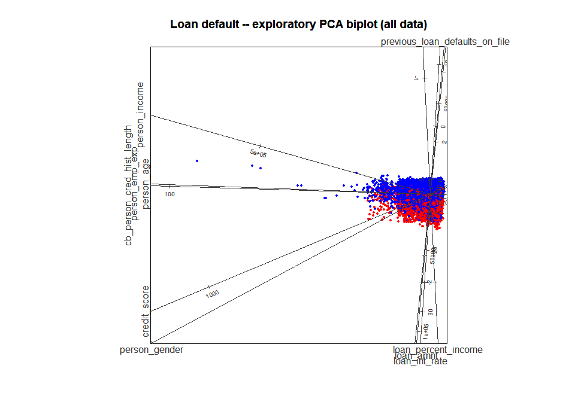
<p class="caption">plot of chunk step2-explore</p>
</div>

```
#> 
#> --- Class summary (no model) ---
#>   Points plotted : 45000
#>   Class 1        : 10000  (22.2 %)
#>   Class 0        : 35000  (77.8 %)
#> --------------------------------
```

**Parameters: `bl_prepare_data()`**

| Parameter | Default | This call | Effect |
|---|---|---|---|
| `class_col` | (required) | `"loan_status"` | The outcome column; it is renamed `class` |
| `target_class` | `NULL` | not set | The class value coded 1; `NULL` needs a 0/1 column, as here |
| `feature_cols` | `NULL` | not set | The features; `NULL` uses every other column |
| `train_fraction` | `0.8` | `1` | Share of rows in the training split; `1` uses every row (no test split) |
| `seed` | `121L` | `121L` | Seed for the train/test split |
| `hull_fraction` | `1` | `1` | Removes the training rows outside the convex hull holding this fraction of them; `1` removes none |

**Parameters: `bl_build_result()`**

| Parameter | Default | This call | Effect |
|---|---|---|---|
| `bl_model` | `NULL` | not set | Without a model the result holds only the projection: no grid or boundary |
| `method` | `"PCA"` | `"PCA"` | The biplot: `"PCA"` (principal components) or `"CVA"` (canonical variates) |
| `standardise` | `TRUE` | default | Standardises the features before PCA (ignored for CVA) |

**Parameters: `plot()` of a biplot** (`?plot_biplotEZ`)

| Parameter | Default | This call | Effect |
|---|---|---|---|
| `label_dir` | `"Paral"` | `"Paral"` | Direction of the axis labels: `"Paral"`, `"Hor"` or `"Orthog"` |
| `label_offset_var`, `label_offset_dist` | `0L`, `1.5` | all ten features | Moves the named axis labels outwards by the paired distance, to stop them overlapping |

**Reading the biplot.** Each point is an application, red for default
and blue for no default. Each straight line is the axis of one feature,
calibrated in that feature's units: the value of a point on a feature
is read by dropping a perpendicular from the point onto that axis.
Axes that point the same way are positively correlated. A few extreme
applications lie far from the others and squeeze the main cloud into a
corner; Step 4 removes such extreme rows from the training data.

------------------------------------------------------------------------

### Step 3: domain filter

The model is built for applicants with **no prior default on file**.
After the filter, `previous_loan_defaults_on_file` is constant, so it is
left out of the features.


``` r
loan_filtered <- loan_encoded[loan_encoded$previous_loan_defaults_on_file == 0, ]

feature_cols <- setdiff(
  names(loan_filtered),
  c("loan_status", "previous_loan_defaults_on_file")
)

cat("Retained rows:", nrow(loan_filtered), "\n")
#> Retained rows: 22142
cat("Features:", paste(feature_cols, collapse = ", "), "\n")
#> Features: person_age, person_gender, person_income, person_emp_exp, loan_amnt, loan_int_rate, loan_percent_income, cb_person_cred_hist_length, credit_score
```

------------------------------------------------------------------------

### Steps 4-6: split the data, fit the model, build the biplot

**Step 4** splits the 22,142
applications 80/20 into training and test rows and removes the
outermost 10% of the training rows (`hull_fraction = 0.9`): the rows
outside the convex hull that holds 90% of them, on a two-dimensional
PCA view of the standardised features. Extreme rows would otherwise
stretch the biplot and its prediction grid. The test rows are never
filtered.


``` r
bl_dat <- bl_prepare_data(
  data           = loan_filtered,
  class_col      = "loan_status",
  feature_cols   = feature_cols,
  train_fraction = 0.8,
  seed           = 121L,
  hull_fraction  = 0.9
)
#> Hull fraction: 0.90 | Retained: 15970 (90.2%) | Removed: 1743 (9.8%)
print(bl_dat)
#> <bl_filter_result>
#>   Hull fraction : 0.90
#>   Retained      : 15970 (90.2%)
#>   Removed       : 1743 (9.8%)
```

If your data is already split, for example by a cross-validation
framework, pass the two splits to `bl_wrap_data()` instead. It does not
filter; `bl_filter_outliers()` can be applied to its result.

**Step 5** fits the model and wraps it. boundarylogic works with a model
fitted anywhere: `bl_wrap_model()` records the model, its features and a
way to score new data. Here the XGBoost model is wrapped as
`model_type = "custom"` with a `predict_fn`, a function of the model and
a data frame that returns one probability of class 1 per row. Any model
can be wrapped this way.


``` r
xgb_data <- xgboost::xgb.DMatrix(
  data  = as.matrix(bl_dat$train_data[, bl_dat$var_names]),
  label = bl_dat$train_data$class
)
xgb_fit <- xgboost::xgb.train(
  params  = list(objective     = "binary:logistic",
                 eval_metric   = "logloss",
                 max_depth     = 3,
                 learning_rate = 0.1),
  data    = xgb_data,
  nrounds = 200,
  verbose = 0
)

bl_mod <- bl_wrap_model(
  model      = xgb_fit,
  model_type = "custom",
  var_names  = bl_dat$var_names,
  predict_fn = function(m, new_data) {
    mat <- xgboost::xgb.DMatrix(as.matrix(new_data))
    as.numeric(predict(m, newdata = mat))
  },
  train_data = bl_dat$train_data
)
print(bl_mod)
#> <bl_model>
#>   Model type    : custom
#>   Cutoff        : 0.5
#>   Train Accuracy: 0.8280  |  Train Gini: 0.8093
#> 
#> --- Model summary ---
#>            Length Class       Mode    
#> model      200    xgb.Booster list    
#> predict_fn   1    -none-      function
#> ---------------------
```

**Parameters: `bl_wrap_model()`**

| Parameter | Default | This call | Effect |
|---|---|---|---|
| `model_type` | (required) | `"custom"` | `"custom"` scores with `predict_fn`; the built-in types (`"GLM"`, `"GAM"`, `"GBM"`, `"LDA"`, `"SVM"`, `"NNET"`, `"RForest"`, `"XGB"`) use their own prediction call (Step 5b shows `"XGB"`) |
| `var_names` | (required) | the nine features | The features the model was trained on, in order |
| `predict_fn` | `NULL` | the function above | `function(model, new_data)` returning probabilities of class 1; required for `"custom"` |
| `train_data` | `NULL` | the training split | Used only to report the training accuracy and Gini |
| `cutoff` | `0.5` | default | The decision threshold. Keep 0.5: the method assumes it |

For a quick baseline, `bl_fit_model()` fits a GLM, SVM, neural network
or random forest directly.

**Step 6** builds the biplot of the model. `bl_build_result()` projects
the training data, lays an `m` × `m` grid over the plane, maps every
grid point back to the features, scores it with the model and draws the
decision boundary where the predicted probability crosses the cutoff.


``` r
bl_results <- bl_build_result(
  bl_data  = bl_dat,
  bl_model = bl_mod,
  method   = "CVA",
  # The trailing "\n" lifts the title clear of the stacked axis labels below.
  title    = "Loan default (no prior default) -- XGB, CVA biplot\n",
  b_margin = 0.001
)
print(bl_results)
#> <bl_result>
#>   Model type   : custom
#>   Method       : CVA
#>   Features     : 9 (person_age, person_gender, person_income, person_emp_exp, loan_amnt, loan_int_rate, loan_percent_income, cb_person_cred_hist_length, credit_score)
#>   Train rows   : 15970  |  Test rows: 4429
#>   Cutoff       : 0.5
#>   Accuracy     : 0.8280  |  Gini: 0.8093
#>   Grid size    : 200 x 200
#>   Grid hull    : outlie = 1.00
#>   Created      : 2026-11-06 23:16:51
```

**Parameters: `bl_build_result()`, with a model**

| Parameter | Default | This call | Effect |
|---|---|---|---|
| `method` | `"PCA"` | `"CVA"` | CVA separates the model's four outcome groups (true and false positives and negatives) as well as two dimensions allow, so the boundary shows clearly |
| `b_margin` | `0.001` | `0.001` | The boundary is drawn from the contours at `cutoff` ± `b_margin` (0.499 and 0.501) |
| `m` | `200L` | default | Grid resolution: 200 × 200 scored points |
| `cva_classes` | `NULL` | default | With a model, CVA uses the four outcome groups (TP, TN, FP, FN) |


``` r
plot(
  bl_results,
  label_dir         = "Hor",
  label_offset_var  = c("loan_amnt", "credit_score"),  # lift two labels
  label_offset_dist = c(1, 1)                          # off their neighbours
)
```

<div class="figure">
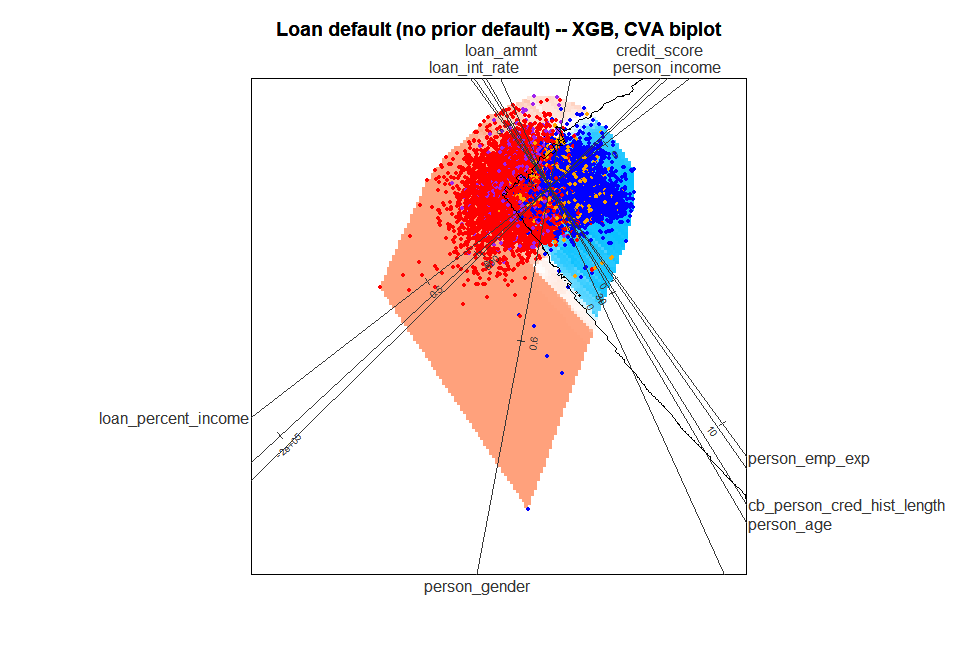
<p class="caption">plot of chunk step6-biplot</p>
</div>

```
#> 
#> --- Prediction summary ---
#>   Points plotted : 15970
#>   Predicted 1    : 6552  (41.0 %)
#>   Predicted 0    : 9418  (59.0 %)
#>   Accuracy       : 13223 / 15970  (82.8 %)
#>   TP / TN / FP / FN : 5472 / 7751 / 1080 / 1667
#> --------------------------
```

**Reading the model biplot.** The background colour is the model's
predicted probability over the plane, and the black line is the
decision boundary. The colour is drawn only inside the convex hull of
the training data, the region the data supports. The training points
are coloured by outcome group: true positive red, true negative blue,
false positive purple, false negative orange.

New rows are drawn on the biplot with `bl_project_points()`, here the
test split. `filter_to_polygon = TRUE` drops the rows that project
outside the training hull.


``` r
test_pts <- bl_project_points(bl_results$test_data, bl_results,
                              filter_to_polygon = TRUE)
plot(bl_results, points = test_pts,
     label_offset_var  = c("loan_amnt", "credit_score",
                           "cb_person_cred_hist_length", "person_age"),
     label_offset_dist = c(1, 1, 1, 2))
```

<div class="figure">
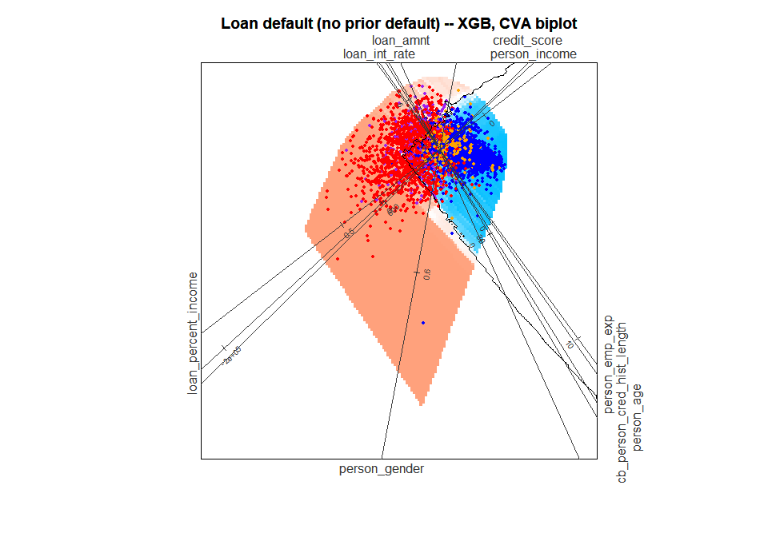
<p class="caption">plot of chunk step6-test</p>
</div>

```
#> 
#> --- Prediction summary ---
#>   Points plotted : 4420
#>   Predicted 1    : 1839  (41.6 %)
#>   Predicted 0    : 2581  (58.4 %)
#>   Accuracy       : 3632 / 4420  (82.2 %)
#>   TP / TN / FP / FN : 1494 / 2138 / 345 / 443
#> --------------------------
```

**Parameters: `bl_project_points()`**

| Parameter | Default | This call | Effect |
|---|---|---|---|
| `filter_to_polygon` | `FALSE` | `TRUE` | Drops rows that project outside the training hull |
| `filter_to_train_ranges` | `FALSE` | default | Drops rows with a feature outside its training range |

------------------------------------------------------------------------

## Phase 2: global interpretation

### Step 7: the nearest boundary point of every test applicant

`bl_find_boundary()` finds, for each test applicant, the nearest point
on the decision boundary in the biplot and maps it back to the
features. This is the applicant's *global counterfactual*. The search
uses only the boundary inside the training hull, and a closed boundary
line only if it encloses training rows, so an applicant's result does
not depend on which other applicants are searched with it. Boundary
points with a feature outside its training range are kept and counted
in a message. The distances it reports (`dist_x`, `dist_mahalanobis`)
are for information: the variable importance below is measured along
the biplot plane.


``` r
bl_bnd <- bl_find_boundary(bl_results)
#> bl_find_boundary(): 27 identified counterfactual(s) are outside the training feature ranges, but are retained.
print(bl_bnd)
#> <bl_boundary>
#>   Observations   : 4429
#>   Boundaries used: 2
#>   Dist Z (mean)  : 0.0105
#>   Dist X (mean)  : 2.9146
#>   Dist M (mean)  : 3.0104 (sqrt of dist_mahalanobis)
#>   B_pred range   : [0.2310, 0.8340]
```

**Parameters: `bl_find_boundary()`**

| Parameter | Default | This call | Effect |
|---|---|---|---|
| `data` | `bl_result$test_data` | default | The rows to search for; `bl_results$train_data` searches the training rows |
| `tdp` | `NULL` | default | Row indices of `data` to process; `NULL` processes all |

`plot()` of the result splits each applicant's distance to its boundary
point into one signed distance per variable. It draws them, prints a
summary and returns the per-variable totals invisibly.


``` r
bnd_imp <- plot(bl_bnd)
```

<div class="figure">
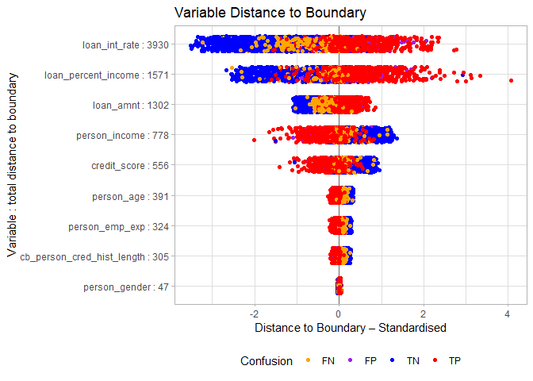
<p class="caption">plot of chunk step7-jitter</p>
</div>

```
#> 
#> Distance metric: mahalanobis
#> Robustness (total distance): 9203.29
#> 
#> Per-variable totals (descending):
#>              loan_int_rate        loan_percent_income 
#>                    3929.71                    1570.78 
#>                  loan_amnt              person_income 
#>                    1301.68                     777.71 
#>               credit_score                 person_age 
#>                     556.06                     390.66 
#>             person_emp_exp cb_person_cred_hist_length 
#>                     323.83                     305.42 
#>              person_gender 
#>                      47.43 
#> 
#> Mahalanobis check (squared distances, summed across obs):
#>   plotted (per feature) = 9675.25 | full d_M^2 = 11754.70 | difference = 2079.45 (+17.7% of full)
```


``` r
plot(bl_bnd, type = "boxplot")
```

<div class="figure">
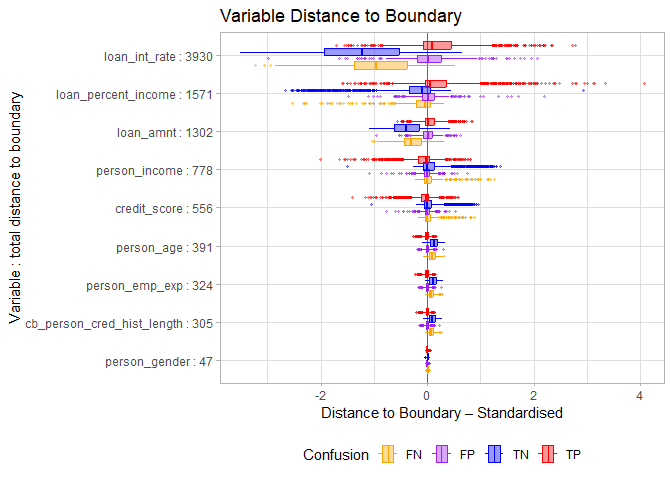
<p class="caption">plot of chunk step7-boxplot</p>
</div>

```
#> 
#> Distance metric: mahalanobis
#> Robustness (total distance): 9203.29
#> 
#> Per-variable totals (descending):
#>              loan_int_rate        loan_percent_income 
#>                    3929.71                    1570.78 
#>                  loan_amnt              person_income 
#>                    1301.68                     777.71 
#>               credit_score                 person_age 
#>                     556.06                     390.66 
#>             person_emp_exp cb_person_cred_hist_length 
#>                     323.83                     305.42 
#>              person_gender 
#>                      47.43 
#> 
#> Mahalanobis check (squared distances, summed across obs):
#>   plotted (per feature) = 9675.25 | full d_M^2 = 11754.70 | difference = 2079.45 (+17.7% of full)
```

**Parameters: `plot()` of a boundary result** (`?plot.bl_boundary`)

| Parameter | Default | This call | Effect |
|---|---|---|---|
| `type` | `"jitter"` | `"jitter"`, then `"boxplot"` | One point per applicant and variable, or box plots per outcome group |
| `distance` | `"auto"` | default | How each variable's distance is standardised: under CVA by its within-class standard deviation (`"mahalanobis"`), under PCA by its total standard deviation (`"euclidean"`) |

**Reading the plot.** Each row is a variable. The label gives its total
absolute standardised distance over all test applicants, and the rows
are sorted from the smallest total (bottom) to the largest (top). A
large total means the variable carries much of the distance to the
boundary: it matters more for the decision. The sign shows on which
side of the boundary an applicant lies along that variable. The
console summary repeats the totals and adds a *Mahalanobis check*: the
per-variable distances ignore the correlations between the variables,
so the check compares their summed squares with the full squared
Mahalanobis distance. Here they fall short of it by
17.7%.


To see one applicant's global counterfactual, click it on the biplot
with `bl_pick_point()` in an interactive session (press Esc to stop).
`bl_bnd` holds one row per test row, so pick from the test data:


``` r
bl_pick_point(bl_results, data = bl_results$test_data, bl_boundary = bl_bnd)
```

------------------------------------------------------------------------

### Prune the least important variables

The per-variable totals rank the variables. Sorted from the weakest:


``` r
var_imp <- sort(bnd_imp$sum_of_distance)   # ascending: weakest first
print(round(var_imp, 2))
#>              person_gender cb_person_cred_hist_length 
#>                      47.43                     305.42 
#>             person_emp_exp                 person_age 
#>                     323.83                     390.66 
#>               credit_score              person_income 
#>                     556.06                     777.71 
#>                  loan_amnt        loan_percent_income 
#>                    1301.68                    1570.78 
#>              loan_int_rate 
#>                    3929.71

vars_to_drop <- c("person_gender", "person_emp_exp",
                  "cb_person_cred_hist_length", "person_income", "person_age")

feature_cols_v2 <- setdiff(bl_dat$var_names, vars_to_drop)
cat("Retained features:", paste(feature_cols_v2, collapse = ", "), "\n")
#> Retained features: loan_amnt, loan_int_rate, loan_percent_income, credit_score
```


The ranking guides the choice: the four weakest variables are dropped.
Two judgements override it:

-   `person_income` is dropped although it outranks `credit_score`
    (777.71 against
    556.06). `loan_percent_income` is
    `loan_amnt / person_income`, so income adds little once both loan
    variables are kept.
-   `credit_score` is kept because an applicant can act on it (Step 10).

The full model's training accuracy is 0.8280 (Gini
0.8093).

------------------------------------------------------------------------

## Refit on the reduced feature set (Steps 4b-6b)

The pipeline is rebuilt on the four kept variables. This time the
features are **standardised** before the model is fitted, as many
models need (XGBoost does not, but the example shows the pattern):

-   The split and the hull filter run on the raw data, with the same seed,
    so the training and test rows are as before (the hull filter
    standardises internally, so it gives the same result on raw or
    standardised data). Only the rows the hull removes differ, because
    the hull is now computed on four features.
-   The means and standard deviations come from the **training rows
    only** and are applied to both splits, so no information leaks from
    the test rows.
-   `bl_set_scaling()` records them, so every plot and print shows
    values in the original units (USD, percent, points). It changes
    only what is displayed: the model, the projection and the grid all
    work in z-scores.


``` r
bl_dat_v2 <- bl_prepare_data(
  data           = loan_filtered,
  class_col      = "loan_status",
  feature_cols   = feature_cols_v2,
  train_fraction = 0.8,
  seed           = 121L,
  hull_fraction  = 0.9
)
#> Hull fraction: 0.90 | Retained: 15996 (90.3%) | Removed: 1717 (9.7%)

# Standardisation fitted on the training rows only
train_scl  <- scale(bl_dat_v2$train_data[, feature_cols_v2])
scl_center <- attr(train_scl, "scaled:center")
scl_scale  <- attr(train_scl, "scaled:scale")

# Apply the training transform to both splits
bl_dat_v2$train_data[, feature_cols_v2] <- train_scl
bl_dat_v2$test_data[,  feature_cols_v2] <-
  scale(bl_dat_v2$test_data[, feature_cols_v2],
        center = scl_center, scale = scl_scale)

# Record the transform, for raw-unit axes and printouts
bl_dat_v2 <- bl_set_scaling(bl_dat_v2,
                            center = scl_center,
                            scale  = scl_scale,
                            method = "z-score")
```

**Parameters: `bl_set_scaling()`**

| Parameter | Default | This call | Effect |
|---|---|---|---|
| `center`, `scale` | (required) | the training means and SDs | The transform `standardised = (raw - center) / scale`, one value per feature |
| `method` | `"z-score"` | `"z-score"` | A label, for reference only |

The reduced model uses the built-in `"XGB"` type: the model is passed as
`list(model = <booster>, features = <feature names>)` and needs no
`predict_fn`.


``` r
xgb_data_v2 <- xgboost::xgb.DMatrix(
  data  = as.matrix(bl_dat_v2$train_data[, bl_dat_v2$var_names]),
  label = bl_dat_v2$train_data$class
)
xgb_fit_v2 <- xgboost::xgb.train(
  params  = list(objective     = "binary:logistic",
                 eval_metric   = "logloss",
                 max_depth     = 3,
                 learning_rate = 0.1),
  data    = xgb_data_v2,
  nrounds = 200,
  verbose = 0
)
bl_mod_v2 <- bl_wrap_model(
  model      = list(model = xgb_fit_v2, features = bl_dat_v2$var_names),
  model_type = "XGB",
  var_names  = bl_dat_v2$var_names,
  train_data = bl_dat_v2$train_data
)
print(bl_mod_v2)
#> <bl_model>
#>   Model type    : XGB
#>   Cutoff        : 0.5
#>   Train Accuracy: 0.8161  |  Train Gini: 0.7747
#> 
#> --- Model summary ---
#>          Length Class       Mode     
#> model    200    xgb.Booster list     
#> features   4    -none-      character
#> ---------------------
```

The reduced model's training accuracy is 0.8161
(Gini 0.7747), against 0.8280 for the
nine-feature model.


``` r
bl_results_v2 <- bl_build_result(
  bl_data  = bl_dat_v2,
  bl_model = bl_mod_v2,
  method   = "CVA",
  title    = "Loan default -- XGB, reduced features, CVA biplot",
  b_margin = 0.01
)
print(bl_results_v2)   # "Axis units : raw (z-score scaling stored)"
#> <bl_result>
#>   Model type   : XGB
#>   Method       : CVA
#>   Features     : 4 (loan_amnt, loan_int_rate, loan_percent_income, credit_score)
#>   Train rows   : 15996  |  Test rows: 4429
#>   Cutoff       : 0.5
#>   Accuracy     : 0.8161  |  Gini: 0.7747
#>   Grid size    : 200 x 200
#>   Grid hull    : outlie = 1.00
#>   Axis units   : raw (z-score scaling stored)
#>   Created      : 2026-11-06 23:17:02

plot(bl_results_v2)
```

<div class="figure">
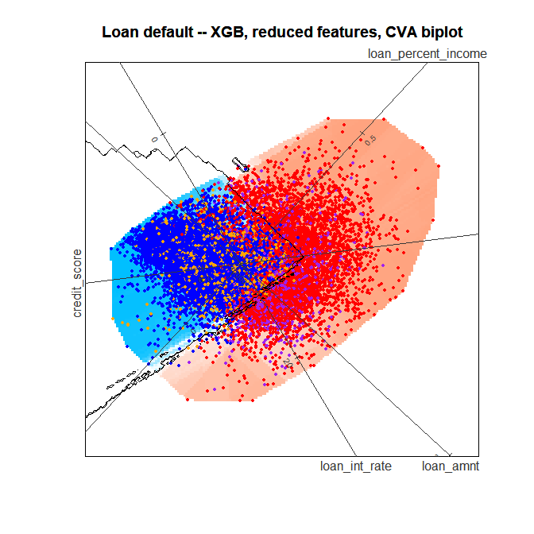
<p class="caption">plot of chunk step6b-build</p>
</div>

```
#> 
#> --- Prediction summary ---
#>   Points plotted : 15996
#>   Predicted 1    : 6474  (40.5 %)
#>   Predicted 0    : 9522  (59.5 %)
#>   Accuracy       : 13055 / 15996  (81.6 %)
#>   TP / TN / FP / FN : 5353 / 7702 / 1121 / 1820
#> --------------------------
```

This build sets `b_margin = 0.01`, so the boundary is drawn from the
contours at 0.49 and 0.51. The axes read in the original units although
the model works in z-scores.


``` r
test_pts_v2 <- bl_project_points(bl_results_v2$test_data, bl_results_v2)
plot(bl_results_v2, points = test_pts_v2)
```

<div class="figure">
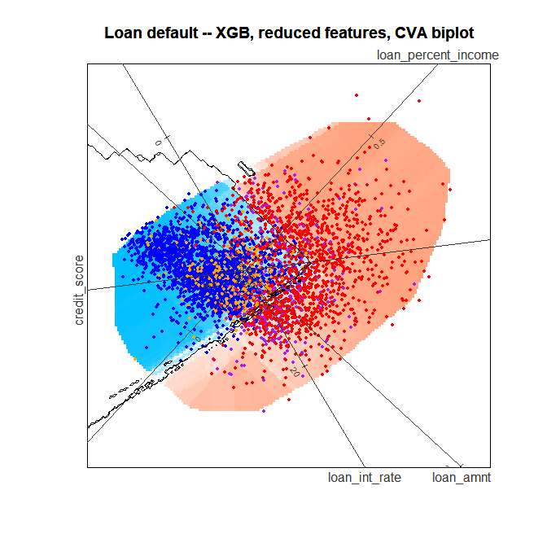
<p class="caption">plot of chunk step6b-test</p>
</div>

```
#> 
#> --- Prediction summary ---
#>   Points plotted : 4429
#>   Predicted 1    : 1800  (40.6 %)
#>   Predicted 0    : 2629  (59.4 %)
#>   Accuracy       : 3595 / 4429  (81.2 %)
#>   TP / TN / FP / FN : 1454 / 2141 / 346 / 488
#> --------------------------
```

------------------------------------------------------------------------

## Phase 2 on the reduced model

### Step 7b: distance to the boundary


``` r
bl_bnd_v2 <- bl_find_boundary(bl_results_v2)
#> bl_find_boundary(): 97 identified counterfactual(s) are outside the training feature ranges, but are retained.
print(bl_bnd_v2)
#> <bl_boundary>
#>   Observations   : 4429
#>   Boundaries used: 18
#>   Dist Z (mean)  : 0.0095
#>   Dist X (mean)  : 1.8120
#>   Dist M (mean)  : 1.9545 (sqrt of dist_mahalanobis)
#>   B_pred range   : [0.2570, 0.8490]
```


``` r
plot(bl_bnd_v2)
```

<div class="figure">
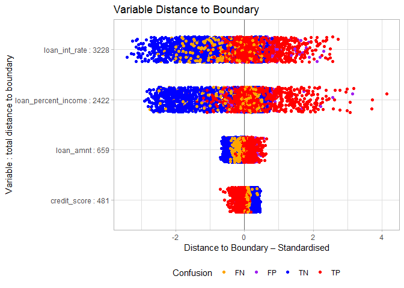
<p class="caption">plot of chunk step7b-jitter</p>
</div>

```
#> 
#> Distance metric: mahalanobis
#> Robustness (total distance): 6790.20
#> 
#> Per-variable totals (descending):
#>       loan_int_rate loan_percent_income           loan_amnt        credit_score 
#>             3227.72             2422.42              658.91              481.15 
#> 
#> Mahalanobis check (squared distances, summed across obs):
#>   plotted (per feature) = 7968.57 | full d_M^2 = 9486.73 | difference = 1518.16 (+16.0% of full)
```


``` r
plot(bl_bnd_v2, type = "boxplot")
```

<div class="figure">
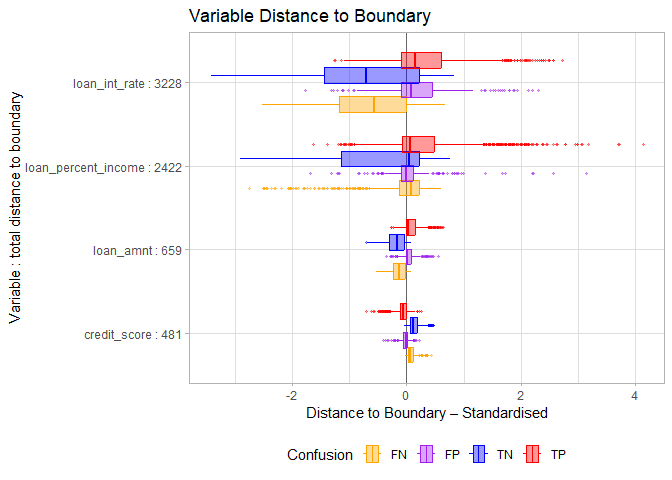
<p class="caption">plot of chunk step7b-boxplot</p>
</div>

```
#> 
#> Distance metric: mahalanobis
#> Robustness (total distance): 6790.20
#> 
#> Per-variable totals (descending):
#>       loan_int_rate loan_percent_income           loan_amnt        credit_score 
#>             3227.72             2422.42              658.91              481.15 
#> 
#> Mahalanobis check (squared distances, summed across obs):
#>   plotted (per feature) = 7968.57 | full d_M^2 = 9486.73 | difference = 1518.16 (+16.0% of full)
```

### Steps 8 and 8b: how faithful is the biplot? `bl_surrogate()`

The biplot shows the model in two dimensions, so it can only
approximate it. `bl_surrogate()` measures how well. It classifies each
training row by its position in the biplot alone, by the side of the
nearest boundary contour, without calling the model, and reports how
often that agrees with the model's own class. A higher agreement means
the biplot represents the model more faithfully.


``` r
bl_surr <- bl_surrogate(bl_results)
print(bl_surr)
#> <bl_surrogate>
#>   Observations        : 15970
#>   Surrogate regions   : 26
#>   Accuracy vs model   : 0.8337  (in-hull: 15970 / 15970 = 100%)
#>   Accuracy vs labels  : 0.7296
plot(bl_surr,
     label_offset_var  = c("loan_amnt", "credit_score",
                           "cb_person_cred_hist_length", "person_age"),
     label_offset_dist = c(1, 1, 1, 2))
```

<div class="figure">
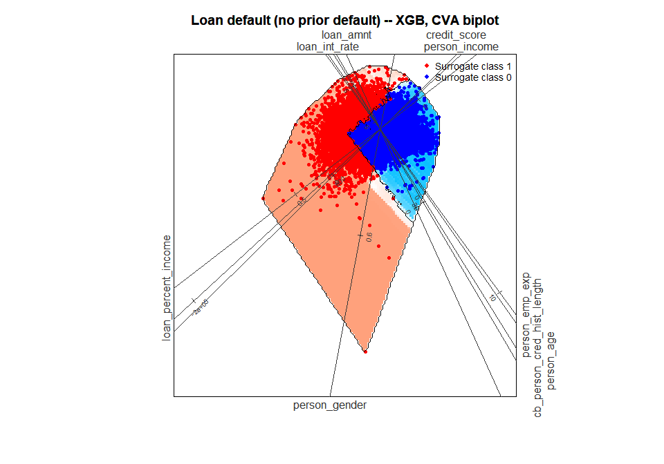
<p class="caption">plot of chunk step8-surrogate</p>
</div>

```
#> Surrogate accuracy vs model : 0.8337
#> Surrogate accuracy vs labels: 0.7296
```


``` r
bl_surr_v2 <- bl_surrogate(bl_results_v2)
print(bl_surr_v2)
#> <bl_surrogate>
#>   Observations        : 15996
#>   Surrogate regions   : 45
#>   Accuracy vs model   : 0.8845  (in-hull: 15996 / 15996 = 100%)
#>   Accuracy vs labels  : 0.7558
plot(bl_surr_v2,
     label_dir         = "Paral",
     label_offset_var  = c("loan_amnt", "loan_int_rate",
                           "loan_percent_income", "credit_score"),
     label_offset_dist = c(0, 0.5, 0, 0),
     ticks_v           = 5)
```

<div class="figure">
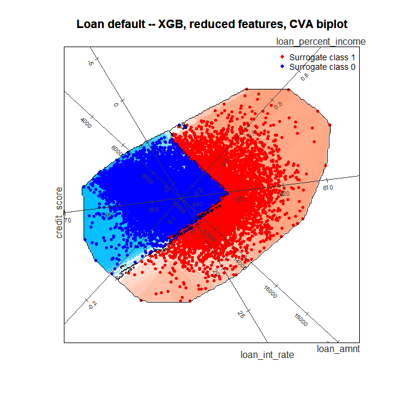
<p class="caption">plot of chunk step8b-surrogate</p>
</div>

```
#> Surrogate accuracy vs model : 0.8845
#> Surrogate accuracy vs labels: 0.7558
```

The biplot agrees with the model on
83.4% of the training rows for the
nine-feature model and on 88.5% for the
reduced model: with fewer variables, two dimensions hold more of the
model.

**Parameters: `bl_surrogate()` and its plot**

| Parameter | Default | This call | Effect |
|---|---|---|---|
| `data` | `bl_result$train_data` | default | The rows to classify |
| `ticks_v` | `1L` | `5L` (8b) | Number of tick marks on every axis; `ticks_var` and `ticks_n` set it per axis |

------------------------------------------------------------------------

## Phase 3: local interpretation of one applicant

All of Phase 3 uses the reduced model, `bl_results_v2`.

### Step 9: choose the applicant

`bl_predict()` scores the test rows and labels each with its outcome
group.


``` r
pred_summary <- bl_predict(bl_results_v2)
head(pred_summary)
#>   row pred_prob pred_class true_class confusion loan_amnt loan_int_rate
#> 1   1     0.810          1          1        TP  4.199532    -0.9009358
#> 2   2     0.521          1          0        FP  4.199532    -1.2315082
#> 3   3     0.827          1          1        TP  3.866329     0.3486275
#> 4   4     0.816          1          1        TP  3.541457     0.8411803
#> 5   5     0.931          1          1        TP  3.366526     1.7403370
#> 6   6     0.415          0          1        FN  3.366526    -1.6546407
#>   loan_percent_income credit_score
#> 1            2.155892   -2.4018549
#> 2            1.042371   -1.4592582
#> 3            2.712653    0.2567511
#> 4            1.265075    0.9093180
#> 5            1.933188    0.1359054
#> 6            1.376427    0.2567511

tdp <- 13
pred_summary[tdp, ]
#>    row pred_prob pred_class true_class confusion loan_amnt loan_int_rate
#> 13  13     0.111          0          0        TN 0.3677028     0.3519332
#>    loan_percent_income credit_score
#> 13           -1.184672   -0.2266318
```


Test row 13 is a **true negative**: the applicant did not default,
and the model predicts a probability of default of
0.111. The question is *what would have
to change for the model to predict default?* It shows how far this
applicant is from being declined. False negatives (defaulters the model
clears) are another natural choice of target.


``` r
target_value <- bl_results_v2$test_data[tdp, ]

plot(
  bl_results_v2,
  plot_points       = FALSE,          # hide the training points
  target_point      = target_value,
  target_label      = tdp,
  label_dir         = "Paral",
  label_offset_var  = c("loan_amnt", "loan_int_rate",
                        "loan_percent_income", "credit_score"),
  label_offset_dist = c(0, 0.5, 0, 0),
  ticks_v           = 3
)
```

<div class="figure">
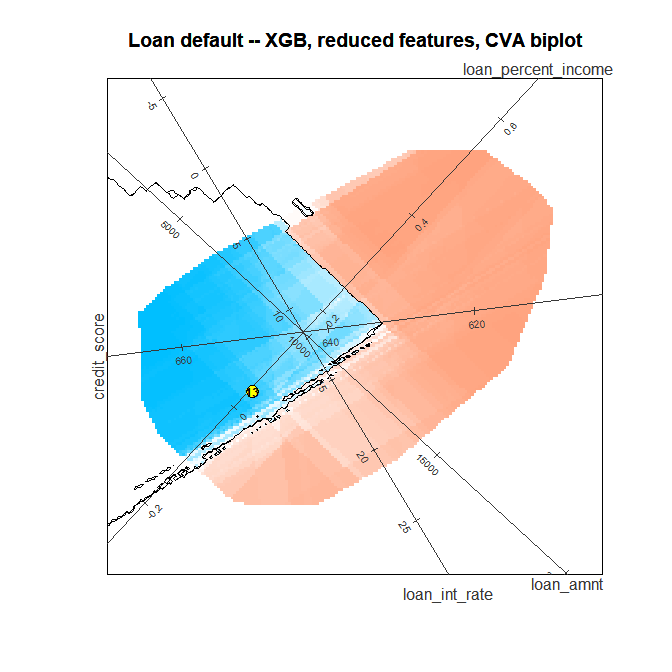
<p class="caption">plot of chunk step9-plot</p>
</div>

```
#> 
#> --- Prediction summary ---
#>   Points plotted : 15996
#>   Predicted 1    : 6474  (40.5 %)
#>   Predicted 0    : 9522  (59.5 %)
#>   Accuracy       : 13055 / 15996  (81.6 %)
#>   TP / TN / FP / FN : 5353 / 7702 / 1121 / 1820
#> --------------------------
```

**Parameters: `plot()` with a target**

| Parameter | Default | This call | Effect |
|---|---|---|---|
| `plot_points` | `TRUE` | `FALSE` | Hides the training (or `points`) rows |
| `target_point`, `target_label` | `NULL` | row 13 | Marks one row and labels it |
| `ticks_v` | `1L` | `3L` | Tick marks per axis |

In an interactive session, clicking the target draws the arrow to its
global counterfactual from Step 7b:


``` r
bl_pick_point(bl_results_v2, data = bl_results_v2$test_data,
              bl_boundary = bl_bnd_v2)
```

------------------------------------------------------------------------

### Step 10: the target and its constraints

`bl_select_target()` takes the applicant: a row index into the test data
(or into `data =`), or a one-row data frame (Step 16). It records the
features, the prediction and the true class.


``` r
tgt <- bl_select_target(bl_results_v2, target = tdp)
print(tgt)
#> -- bl_target --
#>   Row ID         : 13
#>   Predicted prob : 0.1110
#>   Predicted class: 0
#>   Feature values (raw units) :
#>           loan_amnt       loan_int_rate loan_percent_income        credit_score 
#>            12000.00               12.69                0.05              634.00
```

A counterfactual is useful only if the changes it asks for are possible.
`set_filters()` holds the three rules a counterfactual must meet:

-   **Actionability:** per-variable constraints, named after the
    variables.
-   **Plausibility** (`hull = TRUE`): the counterfactual lies inside the
    convex hull of the training data on the plane the search uses, and a
    closed boundary line counts only if it encloses training data.
-   **Feasibility** (`train_ranges = TRUE`): every feature stays within
    its training range.


``` r
flt <- set_filters(
  tgt,
  loan_amnt     = "fixed",                 # the amount applied for stays
  loan_int_rate = "increase",              # may only rise
  credit_score  = c("increase", "integer"), # may only rise, in whole points
  hull          = TRUE,
  train_ranges  = TRUE
)
print(flt)
#> -- bl_filters --
#>   loan_amnt            : fixed
#>   loan_int_rate        : increase
#>   credit_score         : increase, integer
#>   Plausibility (hull)        : on
#>   Feasibility (train_ranges) : on
```

**The constraints `set_filters()` accepts**

| Constraint | Meaning |
|---|---|
| `"increase"` | The counterfactual value is at least the observed value |
| `"decrease"` | The counterfactual value is at most the observed value |
| `"fixed"` | The feature keeps its observed value. The search allows it to move by up to 0.5 model units (a point on the two-dimensional boundary rarely holds a feature exactly), then restores the observed value and re-checks the prediction. If the restored point no longer crosses the boundary, there is no counterfactual |
| `c(min, max)` | The counterfactual value lies in this range, **in model units** (z-scores for `bl_results_v2`; convert with `bl_apply_scaling()`) |
| `"integer"` | A whole number in the original units (a count or a score), alone or combined: `c("increase", "integer")`, `list(c(min, max), "integer")`. The counterfactual is rounded after the search and re-checked |
| `hull = FALSE`, `train_ranges = FALSE` | Drop the plausibility or the feasibility rule |

A variable that is not named can change freely. Only variables in the
model can be named.

------------------------------------------------------------------------

### Step 11: the local counterfactual, `bl_find_local_cf()`

`bl_find_local_cf()` searches for the nearest point across the decision
boundary that meets the constraints:

1.  For each pair of canonical components, it rotates the biplot so the
    plane passes through the target.
2.  It scores a grid on that plane and finds the boundary.
3.  It keeps the boundary points inside the hull on that plane, then
    those that meet the actionability constraints and the training
    ranges, and that the model scores on the other side of the cutoff.
4.  It takes the nearest of them, and over all the pairs the one
    nearest to the target in the original features (under CVA, by the
    Mahalanobis distance).
5.  It restores the `"fixed"` features and rounds the `"integer"` ones,
    and checks that the adjusted point still crosses the boundary.

The progress messages list the distance found on each pair.


``` r
bl_local <- bl_find_local_cf(
  bl_result   = bl_results_v2,
  set_filters = flt,
  bl_target   = tgt
)
#>   Pair 1/6: components (1, 2) ...
#>     Distance: 0.0283 Z  |  3.5800 Mahalanobis (sqrt)
#>   Pair 2/6: components (1, 3) ...
#>     Distance: 0.0278 Z  |  3.5165 Mahalanobis (sqrt)
#>   Pair 3/6: components (2, 3) ...
#>     Distance: 0.0283 Z  |  3.5822 Mahalanobis (sqrt)
#>   Pair 4/6: components (1, 4) ...
#>     Distance: 0.0156 Z  |  1.9674 Mahalanobis (sqrt)
#>   Pair 5/6: components (2, 4) ...
#>     Distance: 0.0276 Z  |  3.4935 Mahalanobis (sqrt)
#>   Pair 6/6: components (3, 4) ...
#>     Distance: 0.0055 Z  |  0.6934 Mahalanobis (sqrt)
#> Best pair: (3, 4) | Selector: Mahalanobis (sqrt) = 0.6934 | Z = 0.0055
#> Fixed feature(s) loan_amnt restored to observed value(s); the restored point still crosses the boundary (pred 0.693) and is used as the counterfactual.
#> Integer feature(s) credit_score rounded to whole values; the rounded point still crosses the boundary (pred 0.693) and is used as the counterfactual.
print(bl_local)
#> -- bl_local_result --
#>   Solution found : TRUE
#>   Best pair      : (3, 4)
#>   Selector       : mahalanobis
#>   Distance (Z)   : 0.0055
#>   Euclidean (X)  : 0.5874 (total-SD scale)
#>   Mahalanobis    : 0.6934 (sqrt of squared d_M^2 = 0.4808)
#>   Boundary pred  : 0.6930
#>   Fixed restored : loan_amnt
#>   Integer rounded : credit_score
#> 
#>   Target:
#> -- bl_target --
#>   Row ID         : 13
#>   Predicted prob : 0.1110
#>   Predicted class: 0
#>   Feature values (raw units) :
#>           loan_amnt       loan_int_rate loan_percent_income        credit_score 
#>            12000.00               12.69              0.0500              634.00 
#> 
#>   Counterfactual:
#> -- bl_counterfactual --
#>   Boundary prob  : 0.6930
#>   Predicted class: 1
#>   Feature values (raw units) :
#>           loan_amnt       loan_int_rate loan_percent_income        credit_score 
#>            12000.00               14.44              0.0457              635.00 
#> 
#>   Per-pair distances:
#>   pair     dist_z    dist_x dist_mahalanobis
#>  (1,2) 0.02830926 2.2489005       12.8162127
#>  (1,3) 0.02780772 2.1554967       12.3661193
#>  (2,3) 0.02832678 2.2510873       12.8320826
#>  (1,4) 0.01555777 1.2202560        3.8707700
#>  (2,4) 0.02762566 2.2367562       12.2047315
#>  (3,4) 0.00548295 0.5873798        0.4807633
#> 
#>   Observed vs counterfactual (raw units):
#>                     observed counterfactual  change        constraint
#> loan_amnt           12000.00       12000.00    0.00             fixed
#> loan_int_rate          12.69          14.44    1.75          increase
#> loan_percent_income   0.0500         0.0457 -0.0043              none
#> credit_score          634.00         635.00    1.00 increase, integer
#> 
#>   Note: loan_amnt is "fixed", but the boundary search moved it to 12523.4436
#>         (+523.4436). The search lets a "fixed" feature move by up to 0.5
#>         model units (+/- 3001.1777 here), because a point on the 2D decision
#>         boundary rarely holds a feature at exactly its observed value.
#>         Restoring loan_amnt to its observed value still crosses the boundary
#>         (prediction 0.6930), so the restored point is the selected
#>         counterfactual.
#> 
#>   Note: credit_score is "integer", and the boundary point has 634.0454. Of
#>         the 2 combinations of the whole values just below and above, 2 still
#>         cross the boundary within the constraints; the nearest, 635
#>         (prediction 0.6930), is the counterfactual.
```


**Parameters: `bl_find_local_cf()`**

| Parameter | Default | This call | Effect |
|---|---|---|---|
| `set_filters` | `NULL` | `flt` | The constraints. `NULL` means no actionability constraint, with the hull and the training ranges still applied |
| `max_pairs` | `21L` | default | Component pairs searched; 21 covers every pair for up to 7 features (6 here) |
| `m` | `200L` | default | Grid resolution on each plane |
| `distance` | `"auto"` | default | How the pairs are compared: Mahalanobis under CVA, Euclidean under PCA |
| `verbose` | `TRUE` | default | Prints the progress messages |

**Reading the result.** The counterfactual raises the interest rate
from 12.69% to
14.44% and the credit score from
634 to 635,
keeps the loan amount, and the model then predicts
0.693: across the cutoff. The table shows each
feature's observed and counterfactual value, the change and the
constraint, in the original units. The notes explain what happened to
the fixed and the integer features.

------------------------------------------------------------------------

### Step 12: the local biplot

`plot()` of the result draws the rotated plane that gave the
counterfactual: the target (filled circle), the counterfactual (cross)
and an arrow between them. As on the global biplot, the prediction
colour is drawn only inside the hull on this plane, the region the
search could use.


``` r
plot(bl_local,
     label_dir         = "Paral",
     label_offset_var  = c("loan_amnt", "loan_int_rate",
                           "loan_percent_income", "credit_score"),
     label_offset_dist = c(0, 0, 1, 0),
     ticks_var         = c("loan_amnt", "loan_int_rate",
                           "loan_percent_income", "credit_score"),
     ticks_n           = c(4, 5, 5, 5))
```

<div class="figure">
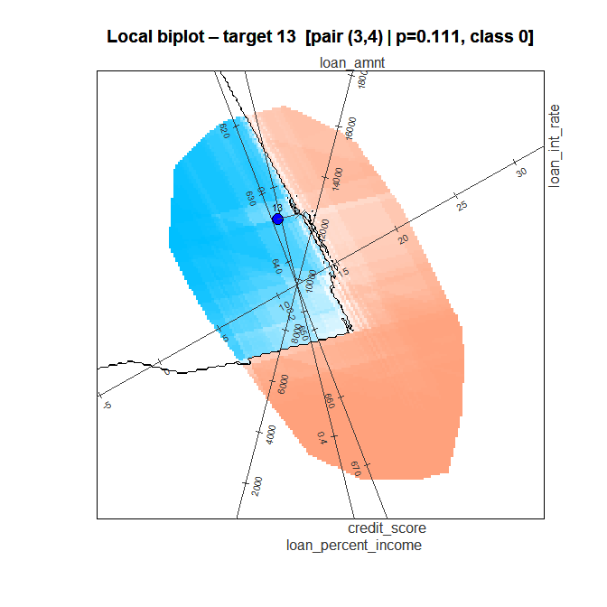
<p class="caption">plot of chunk step12-plot</p>
</div>

```
#> 
#> --- Local CF summary ---
#>   Target         : 13
#>   Pred prob      : 0.1110  (class 0)
#>   Best pair      : (3, 4)
#>   Selector       : mahalanobis
#>   Distance (Z)   : 0.0055
#>   Euclidean (X)  : 0.5874
#>   Mahalanobis    : 0.6934 (sqrt)
#>   Boundary pred  : 0.6930
#> ------------------------
```

**Parameters: `plot()` of a local result** (`?plot.bl_local_result`)

| Parameter | Default | This call | Effect |
|---|---|---|---|
| `ticks_var`, `ticks_n` | `0L`, `5L` | all four, `c(4, 5, 5, 5)` | Tick marks per named axis, paired by position |
| `trim_to_hull` | `NULL` | default | Colours the grid only inside the hull when the search used it |
| `plot_points` | `FALSE` | default | `TRUE` adds the training points |

------------------------------------------------------------------------

### Step 13: which changes matter? `bl_shapley()`

The move from the target to the counterfactual changes several features
at once. `bl_shapley()` splits the change in the predicted probability
among them, with Shapley values, and labels each feature:

-   **Supports:** its change moves the prediction towards the boundary.
-   **Contradicts:** its change moves the prediction away from it.
-   **No effect:** its change does not move the prediction.


``` r
bl_shapley_values <- bl_shapley(bl_local)
print(bl_shapley_values)
#> -- bl_shapley --
#>   Row ID         : 13
#>   Observed pred  : 0.1110  (class 0)
#>   Full CF pred   : 0.6930
#>   Shapley sum    : 0.5820
#> 
#>   Observed vs counterfactual, with Shapley values (raw units):
#>                     observed counterfactual  change        constraint shapley
#> loan_amnt           12000.00       12000.00    0.00             fixed    0.00
#> loan_int_rate          12.69          14.44    1.75          increase    0.44
#> loan_percent_income   0.0500         0.0457 -0.0043              none    0.14
#> credit_score          634.00         635.00    1.00 increase, integer    0.00
#>                     contribute
#> loan_amnt            No effect
#> loan_int_rate         Supports
#> loan_percent_income   Supports
#> credit_score         No effect
plot(bl_shapley_values)
```

<div class="figure">
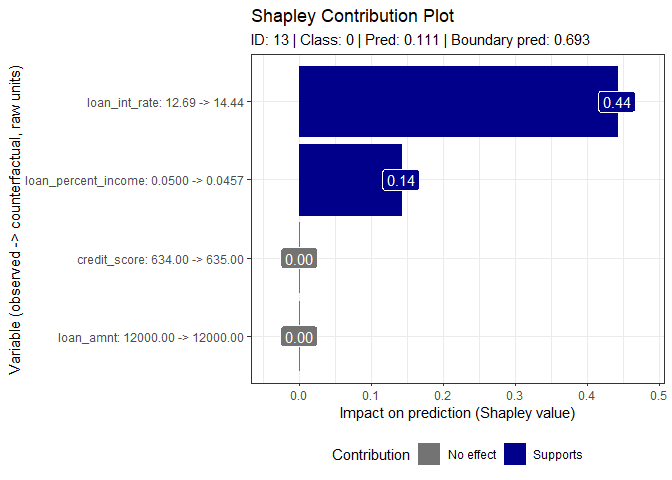
<p class="caption">plot of chunk step13-shapley</p>
</div>

The labels read `variable: observed -> counterfactual`. The values sum
to the change in the prediction, from
0.111 to
0.693. With up to 14 features the
Shapley values are exact; above that, `bl_shapley()` estimates them from
`approx_perm` random permutations (set `seed` to repeat them).

------------------------------------------------------------------------

### Step 14: the sparse counterfactual, `bl_find_sparse_cf()`

A counterfactual that changes fewer features is easier to act on.
`bl_find_sparse_cf()` keeps every Contradicts, No effect and `"fixed"`
feature at its observed value. It changes the Supports features one at a
time, largest Shapley value first, re-scores the model after each, and
stops as soon as the prediction crosses the boundary.


``` r
bl_sparse <- bl_find_sparse_cf(bl_shapley_values)
print(bl_sparse)
#> -- bl_sparse_result --
#>   Solution valid : TRUE
#>   Observed pred  : 0.1110  (class 0)
#>   Full CF pred   : 0.6930
#>   Sparse CF pred : 0.5120
#> 
#>   Observed vs sparse counterfactual (raw units):
#>                     observed counterfactual   sparse change        constraint
#> loan_amnt           12000.00       12000.00 12000.00   0.00             fixed
#> loan_int_rate          12.69          14.44    14.44   1.75          increase
#> loan_percent_income   0.0500         0.0457   0.0500 0.0000              none
#> credit_score          634.00         635.00   634.00   0.00 increase, integer
#>                      used
#> loan_amnt           FALSE
#> loan_int_rate        TRUE
#> loan_percent_income FALSE
#> credit_score        FALSE
#>   (change = sparse - observed)
#> 
#>   Path (Supports features, largest Shapley value first):
#>  step      variable shapley pred crosses
#>     1 loan_int_rate    0.44 0.51    TRUE
plot(bl_sparse,
     new_title         = "Sparse counterfactual, test row 13",
     label_offset_var  = c("loan_amnt", "loan_int_rate",
                           "loan_percent_income", "credit_score"),
     label_offset_dist = c(0, 0, 1, 0),
     ticks_var         = c("loan_amnt", "loan_int_rate",
                           "loan_percent_income", "credit_score"),
     ticks_n           = c(4, 5, 5, 5))
```

<div class="figure">
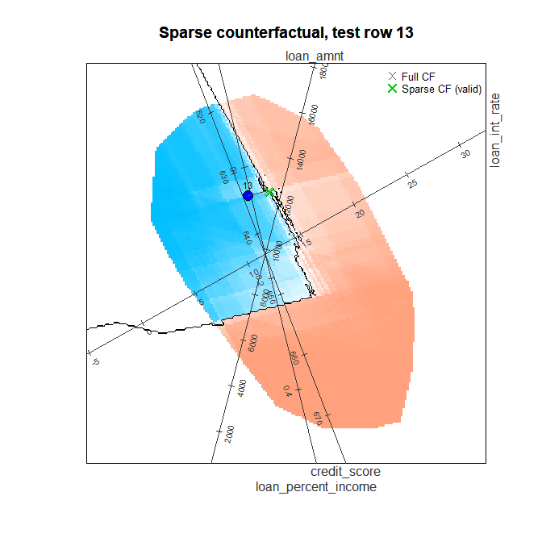
<p class="caption">plot of chunk step14-sparse</p>
</div>

```
#> 
#> --- Sparse CF summary ---
#>   Target         : 13
#>   Observed pred  : 0.1110  (class 0)
#>   Full CF pred   : 0.6930
#>   Sparse CF pred : 0.5120
#>   Solution valid : TRUE
#> -------------------------
```


The path shows the steps: raising the interest rate alone gives
0.51, already across the cutoff, so the
search stops there. The loan-to-income ratio stays at its observed value
although it supports the move, and the credit score, which had no effect,
does too. `solution_valid = TRUE` confirms that the sparse counterfactual
changes the prediction.

------------------------------------------------------------------------

### Step 15: without actionability constraints

Without a `set_filters()` object, the search applies no actionability
constraint but keeps the hull and the training ranges. Comparing it
with Step 11 shows what the constraints cost.
`set_filters(tgt, hull = FALSE, train_ranges = FALSE)` drops those two
rules as well and gives the unconstrained counterfactual.


``` r
bl_local_free <- bl_find_local_cf(bl_results_v2, tgt)
#>   Pair 1/6: components (1, 2) ...
#>     Distance: 0.0067 Z  |  0.8467 Mahalanobis (sqrt)
#>   Pair 2/6: components (1, 3) ...
#>     Distance: 0.0062 Z  |  0.7857 Mahalanobis (sqrt)
#>   Pair 3/6: components (2, 3) ...
#>     Distance: 0.0068 Z  |  0.8587 Mahalanobis (sqrt)
#>   Pair 4/6: components (1, 4) ...
#>     Distance: 0.0048 Z  |  0.6130 Mahalanobis (sqrt)
#>   Pair 5/6: components (2, 4) ...
#>     Distance: 0.0070 Z  |  0.8797 Mahalanobis (sqrt)
#>   Pair 6/6: components (3, 4) ...
#>     Distance: 0.0044 Z  |  0.5554 Mahalanobis (sqrt)
#> Best pair: (3, 4) | Selector: Mahalanobis (sqrt) = 0.5554 | Z = 0.0044
print(bl_local_free)
#> -- bl_local_result --
#>   Solution found : TRUE
#>   Best pair      : (3, 4)
#>   Selector       : mahalanobis
#>   Distance (Z)   : 0.0044
#>   Euclidean (X)  : 0.4902 (total-SD scale)
#>   Mahalanobis    : 0.5554 (sqrt of squared d_M^2 = 0.3084)
#>   Boundary pred  : 0.5420
#> 
#>   Target:
#> -- bl_target --
#>   Row ID         : 13
#>   Predicted prob : 0.1110
#>   Predicted class: 0
#>   Feature values (raw units) :
#>           loan_amnt       loan_int_rate loan_percent_income        credit_score 
#>            12000.00               12.69                0.05              634.00 
#> 
#>   Counterfactual:
#> -- bl_counterfactual --
#>   Boundary prob  : 0.5420
#>   Predicted class: 1
#>   Feature values (raw units) :
#>           loan_amnt       loan_int_rate loan_percent_income        credit_score 
#>            12544.23               14.11                0.04              633.43 
#> 
#>   Per-pair distances:
#>   pair      dist_z    dist_x dist_mahalanobis
#>  (1,2) 0.006695411 0.7296956        0.7168979
#>  (1,3) 0.006213215 0.6707546        0.6173557
#>  (2,3) 0.006790123 0.7404645        0.7373236
#>  (1,4) 0.004847747 0.5297130        0.3758224
#>  (2,4) 0.006956424 0.7706287        0.7738822
#>  (3,4) 0.004391655 0.4902350        0.3084318
#> 
#>   Observed vs counterfactual (raw units):
#>                     observed counterfactual change constraint
#> loan_amnt           12000.00       12544.23 544.23       none
#> loan_int_rate          12.69          14.11   1.42       none
#> loan_percent_income     0.05           0.04  -0.01       none
#> credit_score          634.00         633.43  -0.57       none
plot(bl_local_free,
     label_dir         = "Paral",
     label_offset_var  = c("loan_amnt", "loan_int_rate",
                           "loan_percent_income", "credit_score"),
     label_offset_dist = c(0, 0, 0, 1),
     ticks_var         = c("loan_amnt", "loan_int_rate",
                           "loan_percent_income", "credit_score"),
     ticks_n           = c(4, 10, 10, 10))
```

<div class="figure">
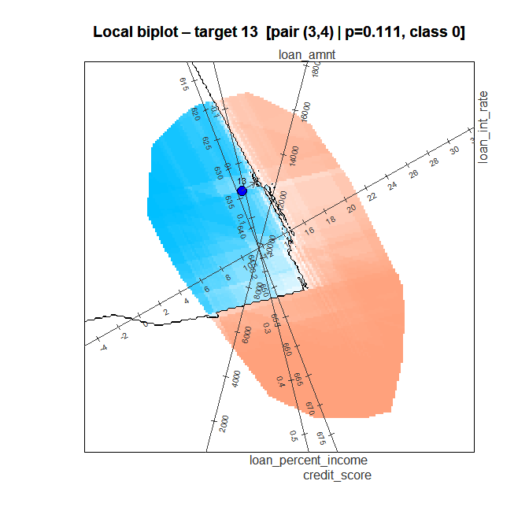
<p class="caption">plot of chunk step15-local</p>
</div>

```
#> 
#> --- Local CF summary ---
#>   Target         : 13
#>   Pred prob      : 0.1110  (class 0)
#>   Best pair      : (3, 4)
#>   Selector       : mahalanobis
#>   Distance (Z)   : 0.0044
#>   Euclidean (X)  : 0.4902
#>   Mahalanobis    : 0.5554 (sqrt)
#>   Boundary pred  : 0.5420
#> ------------------------
```


``` r
bl_shap_free   <- bl_shapley(bl_local_free)
bl_sparse_free <- bl_find_sparse_cf(bl_shap_free)
print(bl_sparse_free)
#> -- bl_sparse_result --
#>   Solution valid : TRUE
#>   Observed pred  : 0.1110  (class 0)
#>   Full CF pred   : 0.5420
#>   Sparse CF pred : 0.5420
#> 
#>   Observed vs sparse counterfactual (raw units):
#>                     observed counterfactual   sparse change constraint  used
#> loan_amnt           12000.00       12544.23 12000.00   0.00       none FALSE
#> loan_int_rate          12.69          14.11    14.11   1.42       none  TRUE
#> loan_percent_income     0.05           0.04     0.04  -0.01       none  TRUE
#> credit_score          634.00         633.43   634.00   0.00       none FALSE
#>   (change = sparse - observed)
#> 
#>   Path (Supports features, largest Shapley value first):
#>  step            variable shapley pred crosses
#>     1       loan_int_rate    0.29 0.36   FALSE
#>     2 loan_percent_income    0.14 0.54    TRUE
plot(bl_shap_free)
```

<div class="figure">
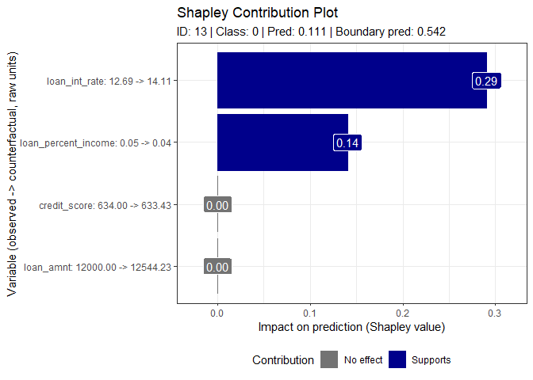
<p class="caption">plot of chunk step15-shapley</p>
</div>


``` r
plot(bl_sparse_free,
     label_dir         = "Paral",
     label_offset_var  = c("loan_amnt", "loan_int_rate",
                           "loan_percent_income", "credit_score"),
     label_offset_dist = c(0, 0, 0, 1),
     ticks_var         = c("loan_amnt", "loan_int_rate",
                           "loan_percent_income", "credit_score"),
     ticks_n           = c(4, 10, 10, 10))
```

<div class="figure">
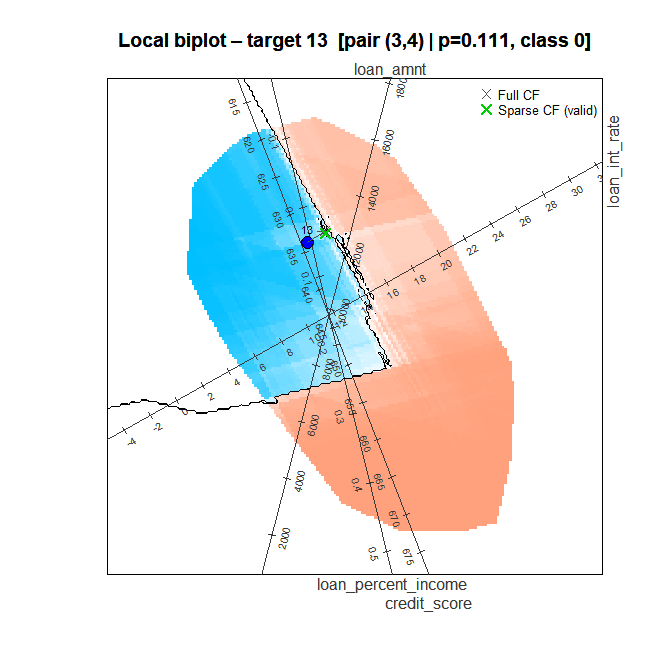
<p class="caption">plot of chunk step15-sparse</p>
</div>

```
#> 
#> --- Sparse CF summary ---
#>   Target         : 13
#>   Observed pred  : 0.1110  (class 0)
#>   Full CF pred   : 0.5420
#>   Sparse CF pred : 0.5420
#>   Solution valid : TRUE
#> -------------------------
```

Without constraints the counterfactual also raises the loan amount and
lowers the credit score, changes the constraints rule out, and it lies
nearer the target (0.56 against
0.69). Its sparse counterfactual
changes the interest rate and the loan-to-income ratio.


------------------------------------------------------------------------

### Step 16: a new applicant

Phase 3 also explains applicants outside the data. Pass a one-row data
frame as the target, with the model's features (other columns are
dropped here). The values are in the original units, and the model works
in z-scores, so `bl_apply_scaling()` converts them first; every function
that takes new data expects model units. No class column is needed.


``` r
new_applicant <- data.frame(
  person_age                 = 32,
  person_gender              = 1,      # male
  person_income              = 248000,
  person_emp_exp             = 5,
  person_home_ownership      = 3,      # RENT
  loan_amnt                  = 12000,
  loan_int_rate              = 13.5,
  loan_percent_income        = 12000 / 248000,
  cb_person_cred_hist_length = 4,
  credit_score               = 420
)
# Keep only the reduced model's features
new_applicant <- new_applicant[, intersect(names(new_applicant), feature_cols_v2),
                               drop = FALSE]
# Raw units to the model's z-scores
new_applicant <- bl_apply_scaling(new_applicant, bl_results_v2)

tgt_ext      <- bl_select_target(bl_results_v2, target = new_applicant)
#> Warning: The target lies outside the training range for: credit_score. By
#> default the local search looks for counterfactuals within that range
#> (set_filters(..., train_ranges = FALSE) drops this rule).
bl_local_ext <- bl_find_local_cf(bl_results_v2, tgt_ext)
#>   Pair 1/6: components (1, 2) ...
#>     Distance: 0.0223 Z  |  2.8241 Mahalanobis (sqrt)
#>   Pair 2/6: components (1, 3) ...
#>     Distance: 0.0227 Z  |  2.8668 Mahalanobis (sqrt)
#>   Pair 3/6: components (2, 3) ...
#>     Distance: 0.0238 Z  |  3.0131 Mahalanobis (sqrt)
#>   Pair 4/6: components (1, 4) ...
#>     Distance: 0.0232 Z  |  2.9337 Mahalanobis (sqrt)
#>   Pair 5/6: components (2, 4) ...
#>     Distance: 0.0242 Z  |  3.0555 Mahalanobis (sqrt)
#>   Pair 6/6: components (3, 4) ...
#>     Distance: 0.0250 Z  |  3.1597 Mahalanobis (sqrt)
#> Best pair: (1, 2) | Selector: Mahalanobis (sqrt) = 2.8241 | Z = 0.0223
print(bl_local_ext)
#> -- bl_local_result --
#>   Solution found : TRUE
#>   Best pair      : (1, 2)
#>   Selector       : mahalanobis
#>   Distance (Z)   : 0.0223
#>   Euclidean (X)  : 2.7859 (total-SD scale)
#>   Mahalanobis    : 2.8241 (sqrt of squared d_M^2 = 7.9757)
#>   Boundary pred  : 0.5410
#> 
#>   Target:
#> -- bl_target --
#>   Row ID         : external
#>   Predicted prob : 0.2960
#>   Predicted class: 0
#>   Feature values (raw units) :
#>           loan_amnt       loan_int_rate loan_percent_income        credit_score 
#>            12000.00               13.50              0.0484              420.00 
#> 
#>   Counterfactual:
#> -- bl_counterfactual --
#>   Boundary prob  : 0.5410
#>   Predicted class: 1
#>   Feature values (raw units) :
#>           loan_amnt       loan_int_rate loan_percent_income        credit_score 
#>            11331.04               14.06              0.0496              534.92 
#> 
#>   Per-pair distances:
#>   pair     dist_z   dist_x dist_mahalanobis
#>  (1,2) 0.02233223 2.785911         7.975668
#>  (1,3) 0.02266993 2.701006         8.218704
#>  (2,3) 0.02382669 2.760514         9.078834
#>  (1,4) 0.02319870 2.765563         8.606571
#>  (2,4) 0.02416199 2.799483         9.336159
#>  (3,4) 0.02498600 2.865789         9.983808
#> 
#>   Observed vs counterfactual (raw units):
#>                     observed counterfactual  change constraint
#> loan_amnt           12000.00       11331.04 -668.96       none
#> loan_int_rate          13.50          14.06    0.56       none
#> loan_percent_income   0.0484         0.0496  0.0012       none
#> credit_score          420.00         534.92  114.92       none
```


`bl_select_target()` warns that the applicant's credit score of 420 lies
below the training range, which starts at 489: the
model has not seen such scores, so treat its explanation with care. The
counterfactual lies inside the training data: inside its convex hull on
the plane and within its ranges, so its credit score is
534.92.


``` r
plot(bl_local_ext)
```

<div class="figure">
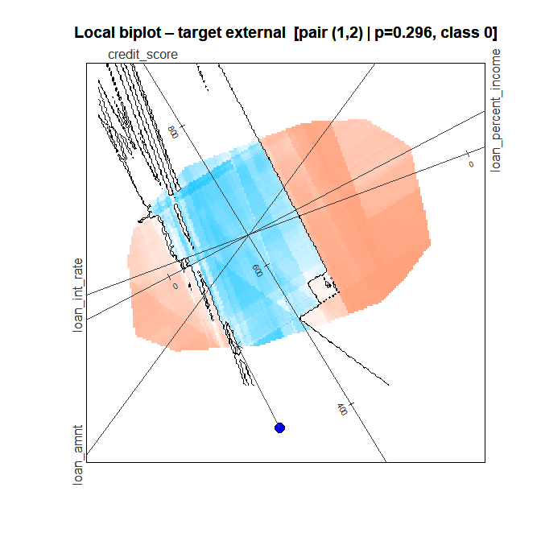
<p class="caption">plot of chunk step16-local</p>
</div>

```
#> 
#> --- Local CF summary ---
#>   Target         : external
#>   Pred prob      : 0.2960  (class 0)
#>   Best pair      : (1, 2)
#>   Selector       : mahalanobis
#>   Distance (Z)   : 0.0223
#>   Euclidean (X)  : 2.7859
#>   Mahalanobis    : 2.8241 (sqrt)
#>   Boundary pred  : 0.5410
#> ------------------------
```


The applicant lies outside the training data on the chosen plane, so the
plot widens its window to show it. The prediction colour covers only the
training data's hull, and the arrow runs from the applicant into it.
(Without a class column, the target is coloured by its predicted class
only.)


``` r
bl_shap_ext   <- bl_shapley(bl_local_ext)
bl_sparse_ext <- bl_find_sparse_cf(bl_shap_ext)
print(bl_sparse_ext)
#> -- bl_sparse_result --
#>   Solution valid : TRUE
#>   Observed pred  : 0.2960  (class 0)
#>   Full CF pred   : 0.5410
#>   Sparse CF pred : 0.5190
#> 
#>   Observed vs sparse counterfactual (raw units):
#>                     observed counterfactual   sparse change constraint  used
#> loan_amnt           12000.00       11331.04 12000.00   0.00       none FALSE
#> loan_int_rate          13.50          14.06    14.06   0.56       none  TRUE
#> loan_percent_income   0.0484         0.0496   0.0484 0.0000       none FALSE
#> credit_score          420.00         534.92   420.00   0.00       none FALSE
#>   (change = sparse - observed)
#> 
#>   Path (Supports features, largest Shapley value first):
#>  step      variable shapley pred crosses
#>     1 loan_int_rate    0.22 0.52    TRUE
plot(bl_shap_ext)
```

<div class="figure">
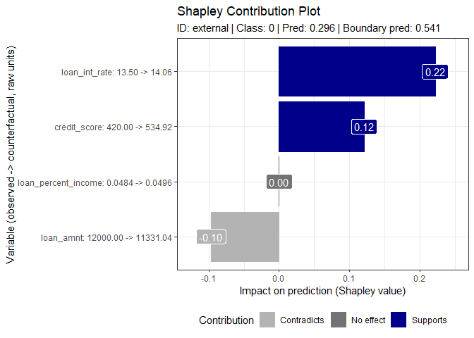
<p class="caption">plot of chunk step16-shapley</p>
</div>


``` r
plot(bl_sparse_ext)
```

<div class="figure">
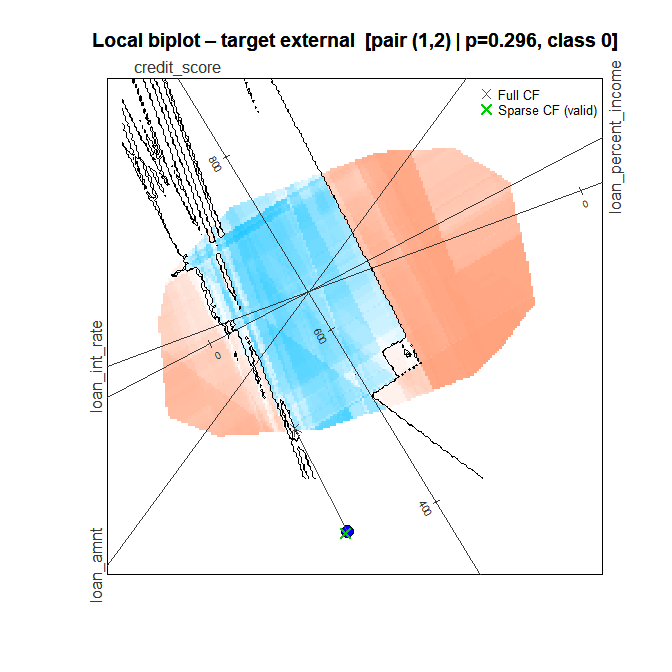
<p class="caption">plot of chunk step16-sparse</p>
</div>

```
#> 
#> --- Sparse CF summary ---
#>   Target         : external
#>   Observed pred  : 0.2960  (class 0)
#>   Full CF pred   : 0.5410
#>   Sparse CF pred : 0.5190
#>   Solution valid : TRUE
#> -------------------------
```


The sparse counterfactual changes only the interest rate. It keeps the
other features at their observed values, so its credit score is the
applicant's 420, outside the training range: `bl_find_sparse_cf()`
checks only that the prediction crosses the boundary.

**Parameters: `bl_apply_scaling()`**

| Parameter | Default | This call | Effect |
|---|---|---|---|
| `data` | (required) | the new applicant | Raw-unit values; other columns are returned unchanged |
| `bl_result` | (required) | `bl_results_v2` | Supplies the scaling recorded by `bl_set_scaling()` |

------------------------------------------------------------------------

## Comparison with SHAP

SHAP (SHapley Additive exPlanations) is the most widely used post-hoc
attribution method. Both SHAP and boundarylogic use Shapley values, but
they answer **different questions**:

-   **SHAP** splits the model's predicted probability for an
    observation, relative to the average prediction over the training
    data. It says *why the score is what it is*.
-   **boundarylogic** measures the distance to the decision boundary
    (globally) and the change that alters the decision (locally). It
    says *what would have to change for the decision to change*.

The chunks below compute SHAP for the **same XGBoost models** with
`fastshap` and `shapviz`. They run only when both packages are
installed.


``` r
if (has_shap) {
  # fastshap needs a prediction wrapper f(object, newdata) -> numeric vector;
  # XGBoost needs the new data as an xgb.DMatrix.
  pred_fn <- function(object, newdata) {
    as.numeric(predict(object, xgboost::xgb.DMatrix(as.matrix(newdata))))
  }

  # Background and explanation data for each model
  X_train_full <- bl_dat$train_data[,    bl_dat$var_names,    drop = FALSE]
  X_train_v2   <- bl_dat_v2$train_data[, bl_dat_v2$var_names, drop = FALSE]
  X_test_v2    <- bl_dat_v2$test_data[,  bl_dat_v2$var_names, drop = FALSE]

  # The reduced model works in z-scores. SHAP is computed on those, but the
  # plots show the feature values in raw units, as boundarylogic does.
  to_raw <- function(X, scaling) {
    X[] <- Map(function(x, v) x * scaling$scale[[v]] + scaling$center[[v]],
               X, names(X))
    X
  }
  X_train_v2_raw <- to_raw(X_train_v2, bl_results_v2$scaling)
  X_test_v2_raw  <- to_raw(X_test_v2,  bl_results_v2$scaling)

  # SHAP baseline: the mean predicted probability over the reduced model's
  # training rows (fastshap does not attach one; shapviz needs it).
  shap_baseline <- mean(pred_fn(xgb_fit_v2, X_train_v2))
}
```

### Global: SHAP against the distance to the boundary

In Phase 2 the distance to the boundary chose the variables to keep.
Here SHAP answers the same question on the **full nine-feature** model:
the variables ranked by their mean absolute SHAP value, beside the
distance ranking.


``` r
if (has_shap) {
  set.seed(42L)
  shap_full <- fastshap::explain(
    object       = xgb_fit,            # full nine-feature model
    X            = X_train_full,
    pred_wrapper = pred_fn,
    nsim         = 50L
  )

  shap_imp <- names(sort(colMeans(abs(as.matrix(shap_full))), decreasing = TRUE))
  dist_imp <- names(sort(bnd_imp$sum_of_distance, decreasing = TRUE))

  print(data.frame(
    rank          = seq_along(shap_imp),
    SHAP          = shap_imp,
    dist_to_bound = dist_imp
  ))
}
#>   rank                       SHAP              dist_to_bound
#> 1    1              loan_int_rate              loan_int_rate
#> 2    2        loan_percent_income        loan_percent_income
#> 3    3              person_income                  loan_amnt
#> 4    4               credit_score              person_income
#> 5    5                  loan_amnt               credit_score
#> 6    6             person_emp_exp                 person_age
#> 7    7                 person_age             person_emp_exp
#> 8    8 cb_person_cred_hist_length cb_person_cred_hist_length
#> 9    9              person_gender              person_gender
```


Both rankings put
loan_int_rate and loan_percent_income
first and the same two variables last, and they differ in the middle.
SHAP ranks a variable by how far it moves the predicted probability
away from the average; the distance ranks it by how much of the
distance to the decision boundary it carries. A variable can move many
scores a little (high SHAP) yet rarely be what carries an applicant
across the boundary, and the reverse.

### Global SHAP for the four kept variables

SHAP on the reduced model, the four variables the workflow kept:


``` r
if (has_shap) {
  set.seed(42L)
  shap_v2 <- fastshap::explain(
    object       = xgb_fit_v2,         # reduced model
    X            = X_train_v2,
    pred_wrapper = pred_fn,
    nsim         = 50L
  )
  sv_v2 <- shapviz::shapviz(as.matrix(shap_v2), X = X_train_v2_raw,
                            baseline = shap_baseline)

  print(shapviz::sv_importance(sv_v2, kind = "bar") +
          ggplot2::labs(title = "Global SHAP importance - reduced XGB model"))
}
```

<div class="figure">
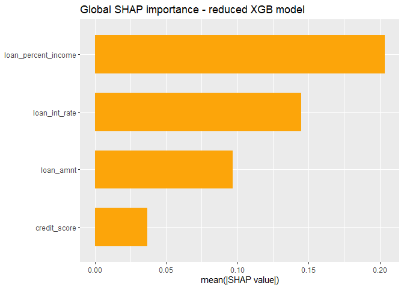
<p class="caption">plot of chunk shap-global-bar</p>
</div>


``` r
if (has_shap) {
  print(shapviz::sv_importance(sv_v2, kind = "beeswarm") +
          ggplot2::labs(title = "Global SHAP beeswarm - reduced XGB model"))
}
```

<div class="figure">
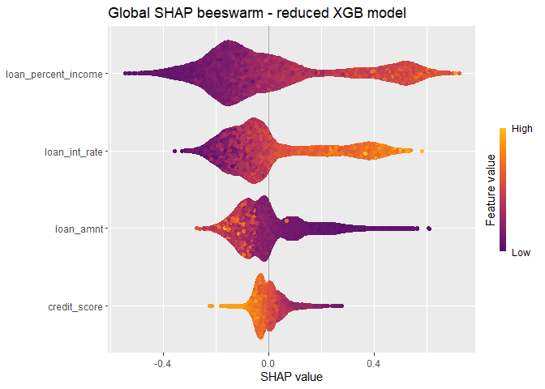
<p class="caption">plot of chunk shap-global-beeswarm</p>
</div>

Compare these with `plot(bl_bnd_v2)` in Step 7b. The bar chart and the
distance totals are both global importance measures. The beeswarm adds
the *direction* in which high and low values push the predicted
probability; the distance plot shows the *signed distance* from each
applicant to the boundary along each variable.

### Local: SHAP against `bl_shapley()`

Local SHAP for the applicant of Phase 3, test row 13:


``` r
if (has_shap) {
  set.seed(42L)
  shap_local <- fastshap::explain(
    object       = xgb_fit_v2,
    X            = X_train_v2,
    pred_wrapper = pred_fn,
    nsim         = 200L,
    newdata      = X_test_v2[tdp, , drop = FALSE],
    adjust       = TRUE          # force additivity: sum(shap) = f(x) - baseline
  )
  sv_local <- shapviz::shapviz(as.matrix(shap_local),
                               X = X_test_v2_raw[tdp, , drop = FALSE],
                               baseline = shap_baseline)

  print(shapviz::sv_waterfall(sv_local) +
          ggplot2::labs(title = sprintf("Local SHAP waterfall - applicant %d", tdp)))
}
```

<div class="figure">
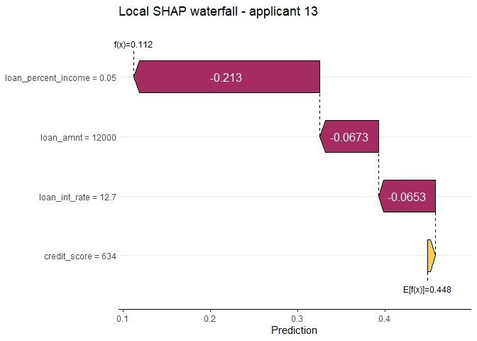
<p class="caption">plot of chunk shap-local</p>
</div>


``` r
if (has_shap) {
  print(shapviz::sv_force(sv_local) +
          ggplot2::labs(title = sprintf("Local SHAP force plot - applicant %d", tdp)))
}
```

<div class="figure">
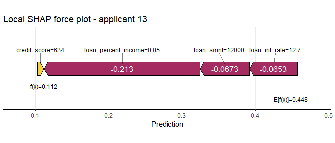
<p class="caption">plot of chunk shap-local-force</p>
</div>

Set beside `plot(bl_shapley_values)` (Step 13):

| Aspect | Local SHAP (waterfall, force) | `bl_shapley()` |
|---|---|---|
| What it explains | The predicted probability for this applicant | The move from this applicant to its counterfactual |
| Reference point | The mean training prediction | The applicant's observed values |
| Reading | Each bar pushes the score up or down | Each bar **Supports** or **Contradicts** crossing the boundary, or has **No effect** |
| Output | A decomposition of the score | A change to act on (`observed -> counterfactual`) |
| Constraints | None | The `set_filters()` rules |

SHAP explains **why the model scored this applicant as it did**;
`bl_shapley()` and the sparse counterfactual say **which feasible change
would alter the decision**. The two complement each other: SHAP to
understand the score, boundarylogic to act on it.

------------------------------------------------------------------------

## Summary

| Phase | Step | Function | Purpose |
|---|---|---|---|
| 1 | 1, 3 | (base R) | Load and encode; domain filter |
| 1 | 2 | `bl_prepare_data()`, `bl_build_result(method = "PCA")` | Exploratory biplot without a model |
| 1 | 4 | `bl_prepare_data()` | Train/test split and hull filter |
| 1 | 5 | `bl_wrap_model()` | Wrap a fitted model (`"custom"` with `predict_fn`) |
| 1 | 6 | `bl_build_result(method = "CVA")`, `bl_project_points()` | Model biplot, decision boundary, test rows |
| 2 | 7 | `bl_find_boundary()`, `plot()` | Global counterfactuals, distance to the boundary per variable |
| 2 | prune | `plot()`'s `sum_of_distance` | Rank the variables, drop the weakest |
| 1 | 4b-6b | `bl_set_scaling()`, `bl_wrap_model(model_type = "XGB")` | Refit on standardised features with raw-unit display |
| 2 | 7b | `bl_find_boundary()` | Distance to the boundary, reduced model |
| 2 | 8, 8b | `bl_surrogate()` | How faithfully the biplot represents the model |
| 3 | 9 | `bl_predict()` | Score the test rows, choose the applicant |
| 3 | 10 | `bl_select_target()`, `set_filters()` | Target, actionability, plausibility and feasibility |
| 3 | 11-12 | `bl_find_local_cf()`, `plot()` | Local counterfactual and its biplot |
| 3 | 13 | `bl_shapley()` | Which changes matter |
| 3 | 14 | `bl_find_sparse_cf()` | Change as few features as needed |
| 3 | 15 | `bl_find_local_cf()` without `set_filters` | The counterfactual without actionability constraints |
| 3 | 16 | `bl_apply_scaling()`, `bl_select_target()` | Explain a new applicant |
| - | - | `fastshap`, `shapviz` | SHAP for the same models, global and local |

boundarylogic and SHAP work best together. SHAP explains the model's
score against an average applicant; boundarylogic places each applicant
relative to the decision boundary and finds the smallest feasible change
that would alter the decision.
